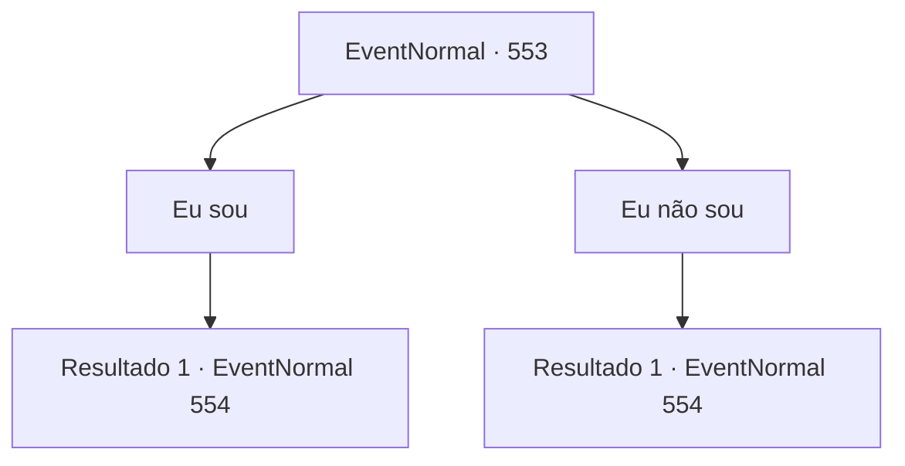

# Eventos normais · 553

[Índice da tabela](index.md) · [Índice geral](../index.md)

ID: `pt:EventNormal:553` · Fonte: `EventNormal4` · Versão: 1.2.47.

Mapeamento estático dos arquivos; a disponibilidade e a execução dependem do estado da run.

## Texto do evento

*Sem texto no arquivo.*

## Dados de entrada

```json
{
  "id": 553,
  "grade": 1,
  "place": "",
  "required": ""
}
```

## Mapa das escolhas



## Escolhas e resultados

### Escolha 1

Eu sou

Requisitos e outros campos da escolha:

```json
{
  "required": ""
}
```

#### Resultado 1.1

Aquele que falou com você ouve sua resposta, olha ao redor cuidadosamente e continua. 

 "Uh... Você acha que pode nos ajudar? Somos estudantes, sabe. Da Ravada Solar. Eu garanto que nosso pedido está totalmente dentro de suas capacidades."

 Segundo ele, os estudantes devem pedir permissão aos professores quando desejam sair. No entanto, devido à grande dificuldade de persuadir os professores a aprovar sua saída, eles simplesmente decidiram sair da universidade por um passagem secreta. Depois de festejar a noite toda, agora precisam voltar por aquela passagem secreta, apenas para descobrir que a passagem está bloqueada. Então agora eles precisam passar pelo portão principal, o que significa que serão pegos pelo porteiro e terão que pagar por sua saída não aprovada. 

 "Seria possível para você... desviar os olhos do porteiro por um momento?"


Continuação registrada: [Evento 554](0554.md) na mesma tabela.

```json
{
  "required": "",
  "chance": "1",
  "nextEvent": 554,
  "type": 2,
  "reward": ""
}
```

### Escolha 2

Eu não sou

Requisitos e outros campos da escolha:

```json
{
  "required": ""
}
```

#### Resultado 2.1

Você responde que não é um aventureiro. Mas ele continua mesmo assim, como se sua resposta não importasse. 

 "Entendo. Isso não é realmente importante. Você acha que pode nos ajudar? Somos estudantes, sabe. De Ravada Solar. Eu garanto que nosso pedido está dentro de suas capacidades."

 Segundo ele, os estudantes devem pedir permissão aos professores quando desejam sair. No entanto, devido à grande dificuldade de persuadir os professores a aprovar sua saída, eles simplesmente decidiram sair da universidade por um passagem secreta. Depois de festejar a noite toda, agora precisam voltar por aquela passagem secreta, apenas para descobrir que a passagem está bloqueada. Então agora eles precisam passar pelo portão principal, o que significa que serão pegos pelos guardas e terão que pagar por sua saída não aprovada. 

 "Seria possível para você... desviar os olhos dos guardas por um momento?"


Continuação registrada: [Evento 554](0554.md) na mesma tabela.

```json
{
  "required": "",
  "chance": "1",
  "nextEvent": 554,
  "type": 2,
  "reward": ""
}
```

## Referências que chegam a este evento

- [Evento 552 · escolha 1 · resultado 1](0552.md#escolha-1)
