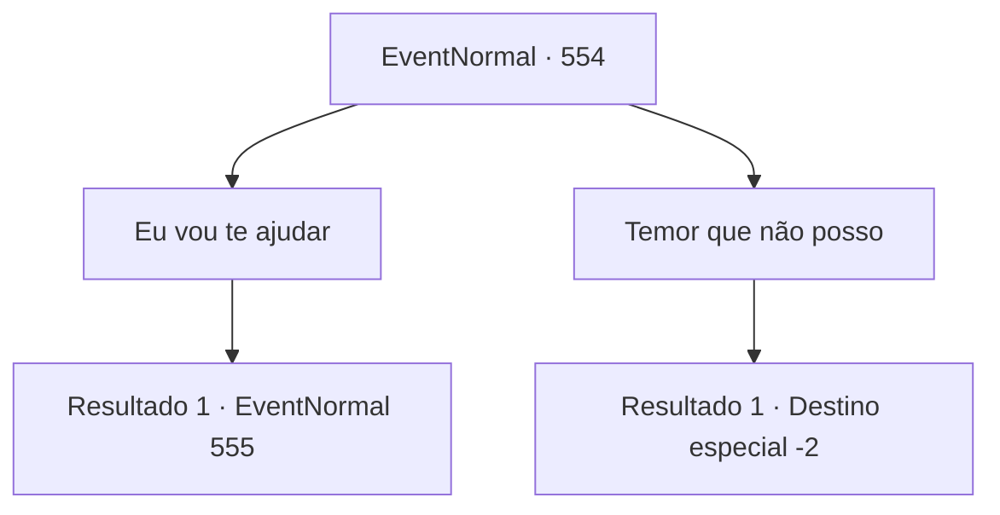

# Eventos normais · 554

[Índice da tabela](index.md) · [Índice geral](../index.md)

ID: `pt:EventNormal:554` · Fonte: `EventNormal4` · Versão: 1.2.47.

Mapeamento estático dos arquivos; a disponibilidade e a execução dependem do estado da run.

## Texto do evento

*Sem texto no arquivo.*

## Dados de entrada

```json
{
  "id": 554,
  "grade": 1,
  "place": "",
  "required": ""
}
```

## Mapa das escolhas



## Escolhas e resultados

### Escolha 1

Eu vou te ajudar

Requisitos e outros campos da escolha:

```json
{
  "required": ""
}
```

#### Resultado 1.1

Você concorda em dar uma mão a eles. Ele responde com um sorriso brilhante. 

 "Muito obrigado. Realmente não podemos nos dar ao luxo de ter mais pontos deduzidos. Ali está - esse é o portão principal da Ravada Solar. Apenas... distraia o porteiro por alguns minutos. Nós vamos passar despercebidos."

 Ele te dá uma pequena quantidade de moedas de ouro pela sua ajuda. Você dá uma olhada nos porteiros, parados em frente ao portão principal. Eles não são apenas guardas, mas paladinos da luz, protegendo firmemente o portão com expressões sérias em seus rostos.

Continuação registrada: [Evento 555](0555.md) na mesma tabela.

```json
{
  "required": "",
  "chance": "1",
  "nextEvent": 555,
  "type": 2,
  "reward": "0_4_20"
}
```

### Escolha 2

Temor que não posso

Requisitos e outros campos da escolha:

```json
{
  "required": ""
}
```

#### Resultado 2.1

Você se recusa a ajudá-los. O grupo de estudantes fica pálido depois de ouvir sua resposta e começa a elaborar novos planos.

Continuação registrada: [Destino especial `-2`](../destinos-especiais.md).

```json
{
  "required": "",
  "chance": "1",
  "nextEvent": -2,
  "type": 2,
  "reward": "5_627_10"
}
```

## Referências que chegam a este evento

- [Evento 553 · escolha 1 · resultado 1](0553.md#escolha-1)
- [Evento 553 · escolha 2 · resultado 1](0553.md#escolha-2)
