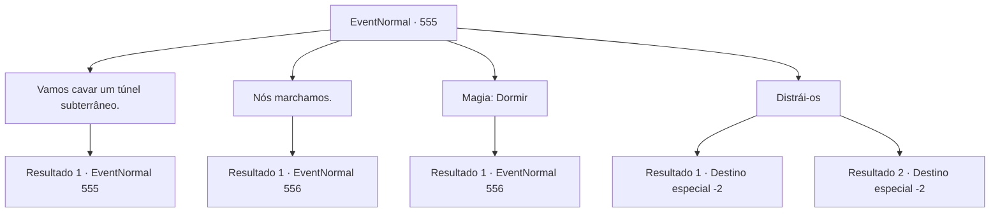

# Eventos normais · 555

[Índice da tabela](index.md) · [Índice geral](../index.md)

ID: `pt:EventNormal:555` · Fonte: `EventNormal4` · Versão: 1.2.47.

Mapeamento estático dos arquivos; a disponibilidade e a execução dependem do estado da run.

## Texto do evento

*Sem texto no arquivo.*

## Dados de entrada

```json
{
  "id": 555,
  "grade": 1,
  "place": "",
  "required": ""
}
```

## Mapa das escolhas



## Escolhas e resultados

### Escolha 1

Vamos cavar um túnel subterrâneo.

Requisitos e outros campos da escolha:

```json
{
  "required": "8_38_1|5_633_0"
}
```

#### Resultado 1.1

Você mostra a eles sua pá e pede para eles cavar um túnel subterrâneo. Mas o aluno responde, balançando a cabeça. 

 "Não temos tempo para isso. Tudo o que temos são algumas horas - com certeza enfrentaremos detenção depois disso."


Continuação registrada: [Evento 555](0555.md) na mesma tabela.

```json
{
  "required": "",
  "chance": "1",
  "nextEvent": 555,
  "type": 2,
  "reward": "5_633_1"
}
```

### Escolha 2

Nós marchamos.

Requisitos e outros campos da escolha:

```json
{
  "required": ""
}
```

#### Resultado 2.1

Você caminha confiante até o portão principal. Os guardiões - os paladinos - te impedem com seus braços. 

 "Pare! Volte. A entrada no campus é estritamente limitada a estudantes e funcionários."

 Você implora para que te deixem entrar, obviamente, ao que eles respondem dizendo não. Agora eles estão alcançando suas poderosas espadas, para te forçar a se afastar.

Continuação registrada: [Evento 556](0556.md) na mesma tabela.

```json
{
  "required": "",
  "chance": "1",
  "nextEvent": 556,
  "type": 2,
  "reward": "6_0_50",
  "place": 4
}
```

### Escolha 3

Magia: Dormir

Requisitos e outros campos da escolha:

```json
{
  "required": "20_0_1"
}
```

#### Resultado 3.1

Você tenta colocá-los para dormir com sua magia. No entanto, aqueles que adoram o deus do sol, da luz e do dia eram imunes ao feitiço de sono. Eles imediatamente percebem sua conjuração de feitiços e começam a correr em sua direção. 

 "Pare aí mesmo, escória criminosa!"


Continuação registrada: [Evento 556](0556.md) na mesma tabela.

```json
{
  "required": "",
  "chance": "1",
  "nextEvent": 556,
  "type": 2,
  "reward": "6_0_50",
  "place": 4
}
```

### Escolha 4

Distrái-os

Requisitos e outros campos da escolha:

```json
{
  "required": ""
}
```

#### Resultado 4.1

Você se aproxima lentamente dos paladinos. Então, você começa a contar histórias na frente deles. Logo, os paladinos estão encantados com seus emocionantes contos de aventuras, tentando se aconchegar a você. Isso é mais do que suficiente para comprar tempo para os estudantes passarem despercebidos pelo portão principal. 

 "Meu Deus. Que grande contador de histórias você é. Você quase nos convenceu, a mim e meus camaradas, a abandonar nossos postos! Tenho que admitir que foi divertido, mas você deveria ir embora agora. Temos um portão principal para vigiar."

 Tendo completado seu objetivo principal, você se curva graciosamente para os paladinos e sai. Os estudantes, agora em segurança no terreno do campus, acenam suas mãos em gratidão de longe.

Continuação registrada: [Destino especial `-2`](../destinos-especiais.md).

```json
{
  "required": "",
  "chance": "1|0_12_1",
  "nextEvent": -2,
  "type": 0,
  "reward": "5_627_2"
}
```

#### Resultado 4.2

Você lentamente se aproxima dos paladinos. Então, você começa a contar histórias na frente deles. A princípio, parece que os paladinos estão ouvindo suas histórias de aventuras - mas logo perdem o interesse. No pior momento possível, também - assim que os estudantes estão tentando passar sorrateiramente pelos paladinos, eles são pegos. 

 "Venham aqui, agora. Nós vemos vocês."

 As expressões dos estudantes se tornam desanimadas. Alguns desistiram voluntariamente, percebendo que o plano falhou. Alguns simplesmente fugiram. Você se afasta da cena de forma desajeitada, tentando não ser pego no fogo cruzado.

Continuação registrada: [Destino especial `-2`](../destinos-especiais.md).

```json
{
  "required": "",
  "chance": "18",
  "nextEvent": -2,
  "type": 1,
  "reward": "5_627_10"
}
```

## Referências que chegam a este evento

- [Evento 554 · escolha 1 · resultado 1](0554.md#escolha-1)
- [Evento 555 · escolha 1 · resultado 1](0555.md#escolha-1)
