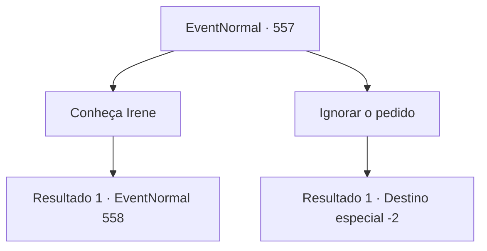

# Eventos normais · 557

[Índice da tabela](index.md) · [Índice geral](../index.md)

ID: `pt:EventNormal:557` · Fonte: `EventNormal4` · Versão: 1.2.47.

Mapeamento estático dos arquivos; a disponibilidade e a execução dependem do estado da run.

## Texto do evento

Em um mural local, um pedaço de papel chama sua atenção. É um pedido, aparentemente escrito por uma mãe, procurando por uma cura para a doença de seu filho. O que é estranho é que a caligrafia é horrível - poderia passar como a escrita de uma criança pequena, que acabou de aprender o alfabeto. 'Meu nome é Irene. Meu filho está enlouquecendo. Nos ajude e eu te recompensarei.'

## Dados de entrada

```json
{
  "id": 557,
  "grade": 1,
  "place": "",
  "required": "5_629_0"
}
```

## Mapa das escolhas



## Escolhas e resultados

### Escolha 1

Conheça Irene

Requisitos e outros campos da escolha:

```json
{
  "required": ""
}
```

#### Resultado 1.1

Você pega o papel do mural e vai para o lugar de Irene. Irene é uma mulher idosa, talvez na casa dos sessenta anos, morando em uma cabana simples. O lugar é construído perto de um pequeno riacho e de um túnel coberto por uma ponte. Você encontra Irene e diz a ela que está aqui sobre o pedido no mural. Ao ouvir isso, ela te recebe em sua cabana. 

 "Isso não é muito, mas por favor."

 Ela volta da cozinha, carregando uma xícara de leite quente e uma batata cozida.

Continuação registrada: [Evento 558](0558.md) na mesma tabela.

```json
{
  "required": "",
  "chance": "1",
  "nextEvent": 558,
  "type": 2,
  "reward": "5_629_1"
}
```

### Escolha 2

Ignorar o pedido

Requisitos e outros campos da escolha:

```json
{
  "required": ""
}
```

#### Resultado 2.1

Você ignora o pedido no quadro e se afasta.

Continuação registrada: [Destino especial `-2`](../destinos-especiais.md).

```json
{
  "required": "",
  "chance": "1",
  "nextEvent": -2,
  "type": 2,
  "reward": "5_629_10"
}
```

## Referências que chegam a este evento

Nenhum `nextEvent` positivo da mesma tabela aponta para este nó. Isso não prova que seja inacessível: sorteio e estado de história podem selecioná-lo.

