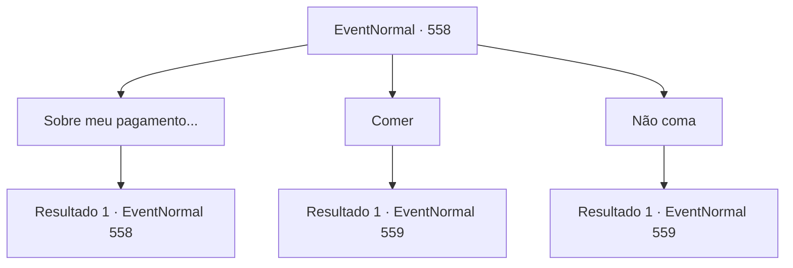

# Eventos normais · 558

[Índice da tabela](index.md) · [Índice geral](../index.md)

ID: `pt:EventNormal:558` · Fonte: `EventNormal4` · Versão: 1.2.47.

Mapeamento estático dos arquivos; a disponibilidade e a execução dependem do estado da run.

## Texto do evento

*Sem texto no arquivo.*

## Dados de entrada

```json
{
  "id": 558,
  "grade": 1,
  "place": "",
  "required": ""
}
```

## Mapa das escolhas



## Escolhas e resultados

### Escolha 1

Sobre meu pagamento...

Requisitos e outros campos da escolha:

```json
{
  "required": "5_630_0"
}
```

#### Resultado 1.1

Você pergunta a ela o que ela pode lhe dar, se você conseguir curar a doença de seu filho. Irene acena os braços em resposta. 

 "O que uma mãe não faria para ver seu filho saudável novamente?! Você pode levar o que quiser."

 Você rapidamente examina a cabana, mas não consegue encontrar nada de valor que valha a pena levar.

Continuação registrada: [Evento 558](0558.md) na mesma tabela.

```json
{
  "required": "",
  "chance": "1",
  "nextEvent": 558,
  "type": 2,
  "reward": "5_630_1"
}
```

### Escolha 2

Comer

Requisitos e outros campos da escolha:

```json
{
  "required": ""
}
```

#### Resultado 2.1

Você decide não deixar a hospitalidade dela ser desperdiçada. Depois de te ver comer, Irene fala. 

 "Eu... tenho um filho. Edin, é o nome dele... Ele está na casa dos vinte agora. Eu sei, eu sei... um nascimento muito tardio, considerando minha idade."

 Segundo ela, Edin começou de repente... a falar em um quarto vazio, como se estivesse conversando com uma pessoa invisível. Isso vem acontecendo há alguns meses agora, e o que é pior, os sintomas parecem estar piorando. 

 "Estou te dizendo, esse não é o tipo de pessoa que meu garotinho é. Ele deve ter sido... amaldiçoado, ou possuído, por um espírito maligno ou algo do tipo."


Continuação registrada: [Evento 559](0559.md) na mesma tabela.

```json
{
  "required": "",
  "chance": "1",
  "nextEvent": 559,
  "type": 2,
  "reward": ""
}
```

### Escolha 3

Não coma

Requisitos e outros campos da escolha:

```json
{
  "required": ""
}
```

#### Resultado 3.1

Você educadamente recusa comer a comida que Irene lhe deu. Você pode ver pela expressão dela que a velha está decepcionada. 

 "Vamos lá, agora... Eu sei que não é um grande banquete, mas pelo menos poderia aliviar sua fome..."

 Ela dá um gole no copo de leite e continua. 

 "Eu... tenho um filho. Edin, é o nome dele... Ele está na casa dos vinte agora. Eu sei, eu sei... um nascimento muito tardio, considerando minha idade."

 Segundo ela, Edin começou de repente... falando em um quarto vazio, como se estivesse conversando com uma pessoa invisível. Isso vem acontecendo há alguns meses agora, e o que é pior, os sintomas parecem estar piorando. 

 "Estou te dizendo, esse não é o tipo de pessoa que meu garotinho é. Ele deve ter sido... amaldiçoado, ou possuído, por um espírito maligno ou algo do tipo."


Continuação registrada: [Evento 559](0559.md) na mesma tabela.

```json
{
  "required": "",
  "chance": "1",
  "nextEvent": 559,
  "type": 2,
  "reward": ""
}
```

## Referências que chegam a este evento

- [Evento 557 · escolha 1 · resultado 1](0557.md#escolha-1)
- [Evento 558 · escolha 1 · resultado 1](0558.md#escolha-1)
