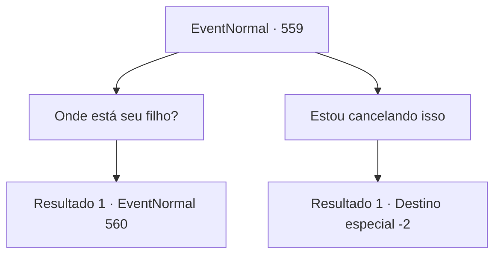

# Eventos normais · 559

[Índice da tabela](index.md) · [Índice geral](../index.md)

ID: `pt:EventNormal:559` · Fonte: `EventNormal4` · Versão: 1.2.47.

Mapeamento estático dos arquivos; a disponibilidade e a execução dependem do estado da run.

## Texto do evento

*Sem texto no arquivo.*

## Dados de entrada

```json
{
  "id": 559,
  "grade": 1,
  "place": "",
  "required": ""
}
```

## Mapa das escolhas



## Escolhas e resultados

### Escolha 1

Onde está seu filho?

Requisitos e outros campos da escolha:

```json
{
  "required": ""
}
```

#### Resultado 1.1

Irene aponta para uma porta. 

 "Lá. Ele está preso dentro daquela sala."

 Você abre a porta rangendo e entra na sala. Só de olhar para Edin uma vez, você pode dizer que ele está severamente desnutrido. Os olhos do menino estão cheios de nervosismo e extrema inquietação. Encarando você com olhos vermelhos, Edin começa a gritar, tentando se esconder sob o cobertor. 

 "Quem... quem diabos é você?! Saia! SAIA!!"


Continuação registrada: [Evento 560](0560.md) na mesma tabela.

```json
{
  "required": "",
  "chance": "1",
  "nextEvent": 560,
  "type": 2,
  "reward": ""
}
```

### Escolha 2

Estou cancelando isso

Requisitos e outros campos da escolha:

```json
{
  "required": ""
}
```

#### Resultado 2.1

Você decide não atender ao pedido de Irene. Ela responde com um suspiro enquanto você se afasta da cabana velha.

Continuação registrada: [Destino especial `-2`](../destinos-especiais.md).

```json
{
  "required": "",
  "chance": "1",
  "nextEvent": -2,
  "type": 2,
  "reward": "5_629_10"
}
```

## Referências que chegam a este evento

- [Evento 558 · escolha 2 · resultado 1](0558.md#escolha-2)
- [Evento 558 · escolha 3 · resultado 1](0558.md#escolha-3)
