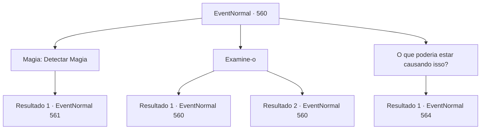

# Eventos normais · 560

[Índice da tabela](index.md) · [Índice geral](../index.md)

ID: `pt:EventNormal:560` · Fonte: `EventNormal4` · Versão: 1.2.47.

Mapeamento estático dos arquivos; a disponibilidade e a execução dependem do estado da run.

## Texto do evento

*Sem texto no arquivo.*

## Dados de entrada

```json
{
  "id": 560,
  "grade": 1,
  "place": "",
  "required": ""
}
```

## Mapa das escolhas



## Escolhas e resultados

### Escolha 1

Magia: Detectar Magia

Requisitos e outros campos da escolha:

```json
{
  "required": "20_0_1"
}
```

#### Resultado 1.1

Você procura a área ao redor dele em busca de sinais de maldições e magia prejudicial. Você detecta um leve rastro de energia mágica, irradiando dos assoalhos. Você diz a Irene que o que está causando dor ao filho dela deve estar no porão. Ouvindo isso, ela alegremente te leva ao porão. O porão cheira a terra e musgo - um cômodo usado como depósito, cheio de sacos de grãos e caixas antigas e empoeiradas. Irene pega uma vassoura e a agita em direção aos ratos, assustando-os longe dos sacos de grãos. Você segue o rastro de energia mágica, chegando ao canto do porão. Lá, você encontra uma lanterna. Não uma lanterna comum, é claro. Dentro da lanterna está a cabeça decepada de uma jovem senhora.

Continuação registrada: [Evento 561](0561.md) na mesma tabela.

```json
{
  "required": "",
  "chance": "1",
  "nextEvent": 561,
  "type": 2,
  "reward": ""
}
```

### Escolha 2

Examine-o

Requisitos e outros campos da escolha:

```json
{
  "required": "5_631_0"
}
```

#### Resultado 2.1

Você observa cuidadosamente Edin, dominado pelo medo. Ele simplesmente não consegue parar de olhar ao redor - ele deve ter certeza de que alguém, ou algo, está o observando. Você percebe que seus lábios estão se movendo em um padrão específico. Edin está sussurrando - você não consegue entender o que ele está dizendo, mas percebe que ele está repetindo... o nome de alguém?

Continuação registrada: [Evento 560](0560.md) na mesma tabela.

```json
{
  "required": "",
  "chance": "1|0_14_1",
  "nextEvent": 560,
  "type": 0,
  "reward": "5_631_1"
}
```

#### Resultado 2.2

Você observa cuidadosamente Edin, dominado pelo medo. Ele simplesmente não consegue parar de olhar ao redor - ele deve ter certeza de que alguém, ou algo, está o observando. Mas além disso, você não consegue obter informações adicionais.

Continuação registrada: [Evento 560](0560.md) na mesma tabela.

```json
{
  "required": "",
  "chance": "16",
  "nextEvent": 560,
  "type": 1,
  "reward": "5_631_2"
}
```

### Escolha 3

O que poderia estar causando isso?

Requisitos e outros campos da escolha:

```json
{
  "required": ""
}
```

#### Resultado 3.1

Você pergunta a Irene se ela tem algum suspeito - eventos recentes, pessoas suspeitas ou objetos desconhecidos, qualquer coisa. Ela balança a cabeça em resposta. 

 "Eu... Eu pensei sobre isso, por muito tempo. Mas eu simplesmente não sei. Até perguntei a um amigo de Edin. Ele parece saber tanto quanto eu."

 Ela consegue lembrar de outro nome, porém. Ela pede para você encontrar e falar com 'Nerev' - um carpinteiro, que costumava sair com seu filho.

Continuação registrada: [Evento 564](0564.md) na mesma tabela.

```json
{
  "required": "",
  "chance": "1",
  "nextEvent": 564,
  "type": 2,
  "reward": ""
}
```

## Referências que chegam a este evento

- [Evento 559 · escolha 1 · resultado 1](0559.md#escolha-1)
- [Evento 560 · escolha 2 · resultado 1](0560.md#escolha-2)
- [Evento 560 · escolha 2 · resultado 2](0560.md#escolha-2)
