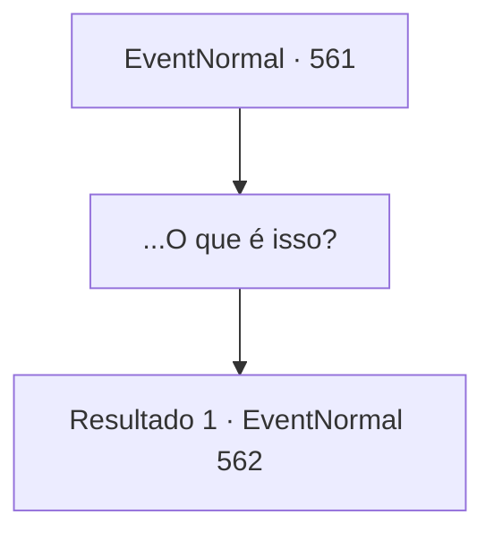

# Eventos normais · 561

[Índice da tabela](index.md) · [Índice geral](../index.md)

ID: `pt:EventNormal:561` · Fonte: `EventNormal4` · Versão: 1.2.47.

Mapeamento estático dos arquivos; a disponibilidade e a execução dependem do estado da run.

## Texto do evento

*Sem texto no arquivo.*

## Dados de entrada

```json
{
  "id": 561,
  "grade": 1,
  "place": "",
  "required": ""
}
```

## Mapa das escolhas



## Escolhas e resultados

### Escolha 1

...O que é isso?

Requisitos e outros campos da escolha:

```json
{
  "required": "5_634_0"
}
```

#### Resultado 1.1

Você mostra a lanterna que encontrou para Irene. Imediatamente, Irene grita, aterrorizada. 

 "Meus deuses! O que é isso?!"

 Irene respira pesadamente por alguns segundos, recupera o fôlego e consegue se acalmar. 

 "Eu reconheço esse rosto. Ela era uma jovem chamada 'Viola'. Uma garota bonita e gentil - Edin costumava persegui-la por toda a cidade."

 Mas aparentemente Viola simplesmente desapareceu um dia, sem deixar rastros. 

 "Ninguém esperava que ela simplesmente sumisse assim, sem avisar ninguém. ...Meu filho teve dificuldades para lidar com isso. M- mas... encontrar ela no porão da minha casa, nesse estado... Como?"


Continuação registrada: [Evento 562](0562.md) na mesma tabela.

```json
{
  "required": "",
  "chance": "1",
  "nextEvent": 562,
  "type": 2,
  "reward": "5_634_1"
}
```

## Referências que chegam a este evento

- [Evento 560 · escolha 1 · resultado 1](0560.md#escolha-1)
