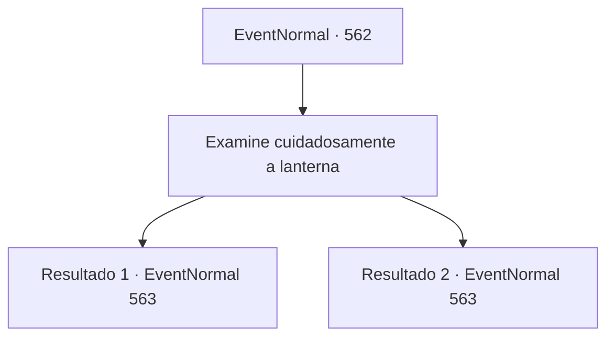

# Eventos normais · 562

[Índice da tabela](index.md) · [Índice geral](../index.md)

ID: `pt:EventNormal:562` · Fonte: `EventNormal4` · Versão: 1.2.47.

Mapeamento estático dos arquivos; a disponibilidade e a execução dependem do estado da run.

## Texto do evento

*Sem texto no arquivo.*

## Dados de entrada

```json
{
  "id": 562,
  "grade": 1,
  "place": "",
  "required": ""
}
```

## Mapa das escolhas



## Escolhas e resultados

### Escolha 1

Examine cuidadosamente a lanterna

Requisitos e outros campos da escolha:

```json
{
  "required": "5_632_0"
}
```

#### Resultado 1.1

Você examina a lanterna. Logo, você percebe um símbolo estranho inscrito em sua superfície. Você percebe que o símbolo está escrito em Sylvan. Você tenta lembrar que tipo de criaturas podem ser capazes de lançar uma maldição em alguém com essa linguagem. As bruxas verdes vêm à sua mente. Uma bruxa verde deve estar causando os sintomas de Edin.

Continuação registrada: [Evento 563](0563.md) na mesma tabela.

```json
{
  "required": "",
  "chance": "1|0_7_1",
  "nextEvent": 563,
  "type": 0,
  "reward": "5_632_1"
}
```

#### Resultado 1.2

Você examina a lanterna. E encontra um padrão gravado nela. Mas não importa o quanto você quebre a cabeça, não consegue descobrir que tipo de padrão é.

Continuação registrada: [Evento 563](0563.md) na mesma tabela.

```json
{
  "required": "",
  "chance": "12",
  "nextEvent": 563,
  "type": 1,
  "reward": "5_632_9"
}
```

## Referências que chegam a este evento

- [Evento 561 · escolha 1 · resultado 1](0561.md#escolha-1)
