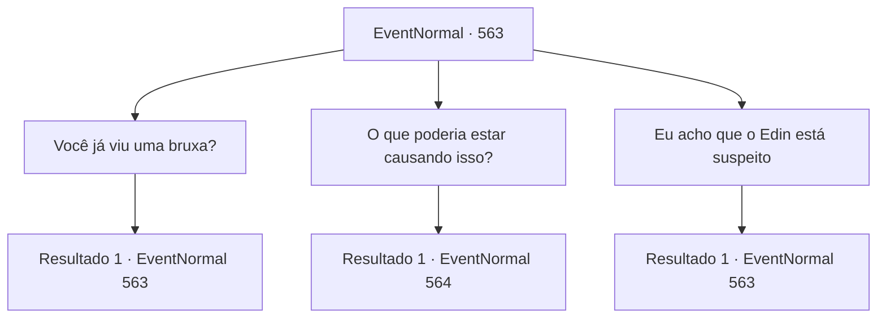

# Eventos normais · 563

[Índice da tabela](index.md) · [Índice geral](../index.md)

ID: `pt:EventNormal:563` · Fonte: `EventNormal4` · Versão: 1.2.47.

Mapeamento estático dos arquivos; a disponibilidade e a execução dependem do estado da run.

## Texto do evento

*Sem texto no arquivo.*

## Dados de entrada

```json
{
  "id": 563,
  "grade": 1,
  "place": "",
  "required": ""
}
```

## Mapa das escolhas



## Escolhas e resultados

### Escolha 1

Você já viu uma bruxa?

Requisitos e outros campos da escolha:

```json
{
  "required": "5_632_1"
}
```

#### Resultado 1.1

Irene responde balançando a cabeça. 

 "Não pessoalmente. Mas ouvi histórias que podem ser sobre bruxas."

 Ela conta uma história sobre uma cabana retorcida, frequentemente avistada pelos locais que atravessam a floresta. Segundo ela, um grupo de lenhadores encontrou a cabana retorcida em um dia muito nebuloso, onde se depararam com uma bruxa verde. 

 "Mas novamente, isso é apenas um rumor. Não posso ter certeza..."


Continuação registrada: [Evento 563](0563.md) na mesma tabela.

```json
{
  "required": "",
  "chance": "0",
  "nextEvent": 563,
  "type": 2,
  "reward": "5_632_2"
}
```

### Escolha 2

O que poderia estar causando isso?

Requisitos e outros campos da escolha:

```json
{
  "required": "18_632_1"
}
```

#### Resultado 2.1

Você pergunta a Irene se ela tem algum suspeito - eventos recentes, pessoas suspeitas ou objetos desconhecidos, qualquer coisa. Ela balança a cabeça em resposta. 

 "Eu... Eu não sei. Nunca esperava encontrar um objeto tão terrível em minha casa em primeiro lugar..."

 Ela consegue lembrar de outro nome, porém. Irene te dá informações sobre um dos amigos de Edin. Aparentemente, seu nome é Nerev, que trabalha em um acampamento de extração de madeira perto da floresta.

Continuação registrada: [Evento 564](0564.md) na mesma tabela.

```json
{
  "required": "",
  "chance": "1",
  "nextEvent": 564,
  "type": 2,
  "reward": ""
}
```

### Escolha 3

Eu acho que o Edin está suspeito

Requisitos e outros campos da escolha:

```json
{
  "required": "5_635_0|18_632_1"
}
```

#### Resultado 3.1

Você diz a Irene que Edin parece suspeito e pode estar tentando esconder sua culpa. Irene estende os braços e fala firmemente. 

 "Não, não. Acredite em mim - meu filho nem mesmo seria capaz de machucar um goblin. Ele é inofensivo! Como ele, com suas próprias mãos, mataria a garota que amava?!"

 Ela garante que Edin nunca faria e nunca poderia cometer um crime assim.

Continuação registrada: [Evento 563](0563.md) na mesma tabela.

```json
{
  "required": "",
  "chance": "1",
  "nextEvent": 563,
  "type": 2,
  "reward": "5_635_1"
}
```

## Referências que chegam a este evento

- [Evento 562 · escolha 1 · resultado 1](0562.md#escolha-1)
- [Evento 562 · escolha 1 · resultado 2](0562.md#escolha-1)
- [Evento 563 · escolha 1 · resultado 1](0563.md#escolha-1)
- [Evento 563 · escolha 3 · resultado 1](0563.md#escolha-3)
