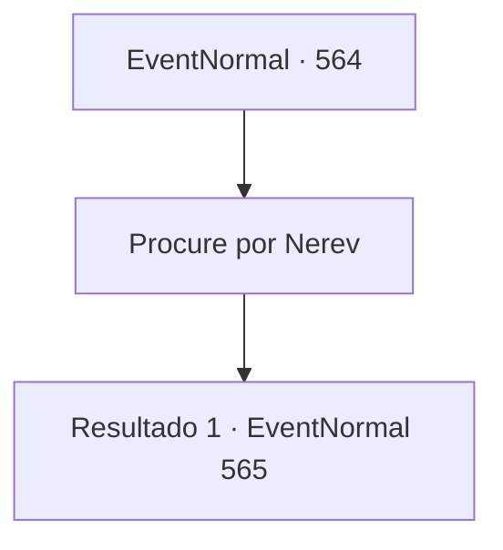

# Eventos normais · 564

[Índice da tabela](index.md) · [Índice geral](../index.md)

ID: `pt:EventNormal:564` · Fonte: `EventNormal4` · Versão: 1.2.47.

Mapeamento estático dos arquivos; a disponibilidade e a execução dependem do estado da run.

## Texto do evento

*Sem texto no arquivo.*

## Dados de entrada

```json
{
  "id": 564,
  "grade": 1,
  "place": "",
  "required": ""
}
```

## Mapa das escolhas



## Escolhas e resultados

### Escolha 1

Procure por Nerev

Requisitos e outros campos da escolha:

```json
{
  "required": ""
}
```

#### Resultado 1.1

Você se dirige ao acampamento de extração de madeira perto da floresta. Lá, você encontra Nerev - um homem robusto e peludo, trabalhando incansavelmente, transportando pedaços de madeira para lá e para cá. Ele te avista e fala. 

 "Ei, você aí. Pode dar licença? Estou tentando trabalhar aqui."

 Você diz a ele que tem algumas perguntas. Nerev coloca o tronco no chão e responde. 

 "...O que é?"


Continuação registrada: [Evento 565](0565.md) na mesma tabela.

```json
{
  "required": "",
  "chance": "1",
  "nextEvent": 565,
  "type": 2,
  "reward": ""
}
```

## Referências que chegam a este evento

- [Evento 560 · escolha 3 · resultado 1](0560.md#escolha-3)
- [Evento 563 · escolha 2 · resultado 1](0563.md#escolha-2)
