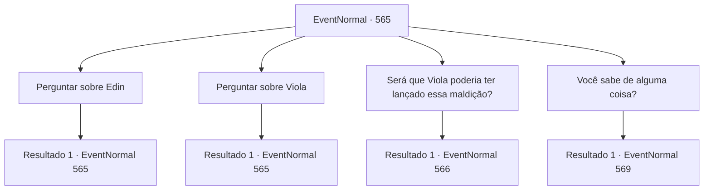

# Eventos normais · 565

[Índice da tabela](index.md) · [Índice geral](../index.md)

ID: `pt:EventNormal:565` · Fonte: `EventNormal4` · Versão: 1.2.47.

Mapeamento estático dos arquivos; a disponibilidade e a execução dependem do estado da run.

## Texto do evento

*Sem texto no arquivo.*

## Dados de entrada

```json
{
  "id": 565,
  "grade": 1,
  "place": "",
  "required": ""
}
```

## Mapa das escolhas



## Escolhas e resultados

### Escolha 1

Perguntar sobre Edin

Requisitos e outros campos da escolha:

```json
{
  "required": "5_636_0"
}
```

#### Resultado 1.1

Você questiona Nerev sobre Edin. Ele sacode as lascas de madeira das mãos e responde. 

 "Ufa... Edin... aquele pobre rapaz."

 Nerev se lembra de Edin como um amigo brilhante e alegre. Mas aparentemente, assim que Viola desapareceu, ele começou a agir de forma estranha. A loucura com a qual ele está afligido agora parece ter começado naquele dia também.

Continuação registrada: [Evento 565](0565.md) na mesma tabela.

```json
{
  "required": "",
  "chance": "1",
  "nextEvent": 565,
  "type": 2,
  "reward": "5_636_1"
}
```

### Escolha 2

Perguntar sobre Viola

Requisitos e outros campos da escolha:

```json
{
  "required": "5_705_0|5_634_1"
}
```

#### Resultado 2.1

Você questiona Nerev sobre Viola. Nerev franze a testa e responde. 

 "Viola... Ela entrou direto na floresta um dia, como se estivesse encantada por alguém. Ninguém sabe o que aconteceu com ela depois, ou onde ela está agora."


Continuação registrada: [Evento 565](0565.md) na mesma tabela.

```json
{
  "required": "",
  "chance": "1",
  "nextEvent": 565,
  "type": 2,
  "reward": "5_705_1"
}
```

### Escolha 3

Será que Viola poderia ter lançado essa maldição?

Requisitos e outros campos da escolha:

```json
{
  "required": "5_636_1|5_705_1"
}
```

#### Resultado 3.1

Nerev responde com um longo suspiro. 

 "Hm... Eu suponho que ela poderia ter feito isso. Quero dizer, Edin começou a enlouquecer logo após ela desaparecer. Mas não há evidências concretas, receio. A menos que você encontre Viola e a questione pessoalmente..."


Continuação registrada: [Evento 566](0566.md) na mesma tabela.

```json
{
  "required": "",
  "chance": "1",
  "nextEvent": 566,
  "type": 2,
  "reward": ""
}
```

### Escolha 4

Você sabe de alguma coisa?

Requisitos e outros campos da escolha:

```json
{
  "required": "5_636_1"
}
```

#### Resultado 4.1

Nerev balança a cabeça em resposta à sua pergunta. 

 "Eu não sei de nada. Por favor, vá embora agora."

 Ele acena com a mão como se espantasse uma mosca e volta para dentro da serraria. Você decide simplesmente entrar na floresta. Assim que você entra, sente uma presença viscosa e pegajosa se enrolar em torno do seu corpo. Parece piorar à medida que você alcança as partes mais profundas da floresta. Depois de alguns minutos de caminhada, você percebe que está de volta ao ponto de partida. É como se a própria floresta estivesse determinada a te confundir.

Continuação registrada: [Evento 569](0569.md) na mesma tabela.

```json
{
  "required": "",
  "chance": "1",
  "nextEvent": 569,
  "type": 2,
  "reward": "5_629_10"
}
```

## Referências que chegam a este evento

- [Evento 564 · escolha 1 · resultado 1](0564.md#escolha-1)
- [Evento 565 · escolha 1 · resultado 1](0565.md#escolha-1)
- [Evento 565 · escolha 2 · resultado 1](0565.md#escolha-2)
