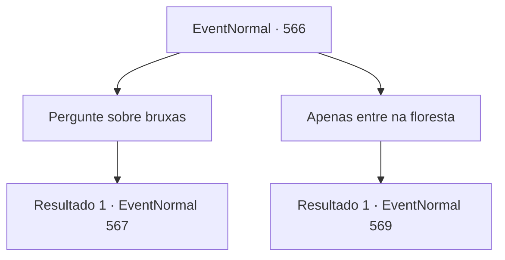

# Eventos normais · 566

[Índice da tabela](index.md) · [Índice geral](../index.md)

ID: `pt:EventNormal:566` · Fonte: `EventNormal4` · Versão: 1.2.47.

Mapeamento estático dos arquivos; a disponibilidade e a execução dependem do estado da run.

## Texto do evento

*Sem texto no arquivo.*

## Dados de entrada

```json
{
  "id": 566,
  "grade": 1,
  "place": "",
  "required": ""
}
```

## Mapa das escolhas



## Escolhas e resultados

### Escolha 1

Pergunte sobre bruxas

Requisitos e outros campos da escolha:

```json
{
  "required": "5_632_2"
}
```

#### Resultado 1.1

Você pergunta a Nerev se ele já viu uma bruxa verde por perto. Ele não responde. Ele simplesmente mantém a boca fechada. Depois de um breve momento de silêncio constrangedor, Nerev falou cuidadosamente. 

 "Esse é um assunto sobre o qual é melhor não falarmos. Acho melhor você ir embora agora."

 Nerev corre para dentro do moinho de madeira, visivelmente abalado ou nervoso.

Continuação registrada: [Evento 567](0567.md) na mesma tabela.

```json
{
  "required": "",
  "chance": "1",
  "nextEvent": 567,
  "type": 2,
  "reward": ""
}
```

### Escolha 2

Apenas entre na floresta

Requisitos e outros campos da escolha:

```json
{
  "required": ""
}
```

#### Resultado 2.1

Você decide simplesmente entrar na floresta. Assim que você entra, sente uma presença viscosa e pegajosa se enrolar em torno do seu corpo. Parece piorar à medida que você alcança as partes mais profundas da floresta. Depois de alguns minutos de caminhada, você percebe que está de volta ao ponto de partida. É como se a própria floresta estivesse determinada a te confundir.

Continuação registrada: [Evento 569](0569.md) na mesma tabela.

```json
{
  "required": "",
  "chance": "1",
  "nextEvent": 569,
  "type": 2,
  "reward": ""
}
```

## Referências que chegam a este evento

- [Evento 565 · escolha 3 · resultado 1](0565.md#escolha-3)
