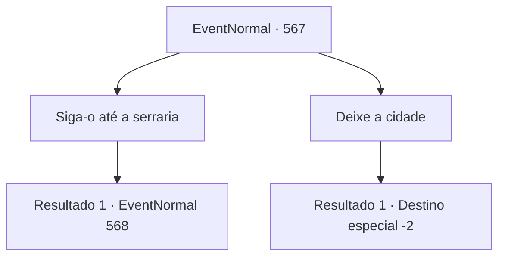

# Eventos normais · 567

[Índice da tabela](index.md) · [Índice geral](../index.md)

ID: `pt:EventNormal:567` · Fonte: `EventNormal4` · Versão: 1.2.47.

Mapeamento estático dos arquivos; a disponibilidade e a execução dependem do estado da run.

## Texto do evento

*Sem texto no arquivo.*

## Dados de entrada

```json
{
  "id": 567,
  "grade": 1,
  "place": "",
  "required": ""
}
```

## Mapa das escolhas



## Escolhas e resultados

### Escolha 1

Siga-o até a serraria

Requisitos e outros campos da escolha:

```json
{
  "required": ""
}
```

#### Resultado 1.1

Você segue Nerev até a serraria. Ele está resmungando consigo mesmo, fazendo o possível para te ignorar.

Continuação registrada: [Evento 568](0568.md) na mesma tabela.

```json
{
  "required": "",
  "chance": "1",
  "nextEvent": 568,
  "type": 2,
  "reward": ""
}
```

### Escolha 2

Deixe a cidade

Requisitos e outros campos da escolha:

```json
{
  "required": ""
}
```

#### Resultado 2.1

Você decide abandonar o pedido de Irene e deixar a cidade.

Continuação registrada: [Destino especial `-2`](../destinos-especiais.md).

```json
{
  "required": "",
  "chance": "1",
  "nextEvent": -2,
  "type": 2,
  "reward": "5_629_10"
}
```

## Referências que chegam a este evento

- [Evento 566 · escolha 1 · resultado 1](0566.md#escolha-1)
