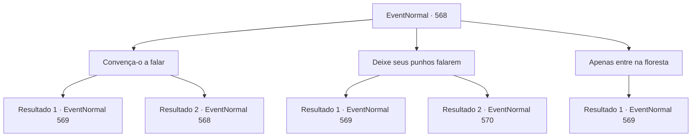

# Eventos normais · 568

[Índice da tabela](index.md) · [Índice geral](../index.md)

ID: `pt:EventNormal:568` · Fonte: `EventNormal4` · Versão: 1.2.47.

Mapeamento estático dos arquivos; a disponibilidade e a execução dependem do estado da run.

## Texto do evento

*Sem texto no arquivo.*

## Dados de entrada

```json
{
  "id": 568,
  "grade": 1,
  "place": "",
  "required": ""
}
```

## Mapa das escolhas



## Escolhas e resultados

### Escolha 1

Convença-o a falar

Requisitos e outros campos da escolha:

```json
{
  "required": "5_637_0"
}
```

#### Resultado 1.1

Finalmente, Nerev solta um longo suspiro e cede à sua tenacidade. Ele aponta para fora do moinho de madeira, na direção da floresta. 

 "Quando você achar que está perdido, coloque sua mão esquerda no chão e continue. E nunca deixe ninguém saber que eu te disse isso."

 Essa é a última coisa que você ouve ele dizer. Você se afasta do moinho de madeira e entra na floresta, em busca da bruxa. Assim que você entra, sente uma presença viscosa e pegajosa se enrolar em torno do seu corpo. Parece piorar à medida que você alcança as partes mais profundas da floresta. Depois de alguns minutos de caminhada, percebe que está de volta onde começou. Como se a própria floresta estivesse determinada a te confundir.

Continuação registrada: [Evento 569](0569.md) na mesma tabela.

```json
{
  "required": "",
  "chance": "1|0_12_1",
  "nextEvent": 569,
  "type": 0,
  "reward": "5_638_1"
}
```

#### Resultado 1.2

Você tenta arrancar informações sobre bruxas de Nerev. No entanto, ele simplesmente continua trabalhando na serraria, sem te responder.

Continuação registrada: [Evento 568](0568.md) na mesma tabela.

```json
{
  "required": "",
  "chance": "24",
  "nextEvent": 568,
  "type": 1,
  "reward": "5_637_1"
}
```

### Escolha 2

Deixe seus punhos falarem

Requisitos e outros campos da escolha:

```json
{
  "required": ""
}
```

#### Resultado 2.1

Você se aproxima de Nerev, o agarra pelo pescoço e começa a sacudir. Ele tenta se libertar, sem sucesso. 

 "Arrgh...! *tosse*.."

 Finalmente, Nerev cede, seu rosto já vermelho, apontando na direção da floresta. Você o solta, e ele respira ofegante. 

 "Maldito... Você cabeça-quente...! Procure por uma cabana... no centro da floresta."

 Você se afasta do moinho de madeira e entra na floresta, em busca da bruxa. Assim que você entra, sente uma presença viscosa e pegajosa se enrolar em seu corpo. Parece piorar à medida que você alcança as partes mais profundas da floresta. Depois de alguns minutos de caminhada, percebe que está de volta onde começou. É como se a própria floresta estivesse determinada a te confundir.

Continuação registrada: [Evento 569](0569.md) na mesma tabela.

```json
{
  "required": "",
  "chance": "1|0_5_1",
  "nextEvent": 569,
  "type": 0,
  "reward": ""
}
```

#### Resultado 2.2

Você se aproxima de Nerev, o agarra pelo pescoço e começa a sacudir. Ele empurra seus braços para longe, gritando com raiva. 

 "Você enlouqueceu...?!"

 Nerev pega um machado de lenhador e começa a balançar.

Continuação registrada: [Evento 570](0570.md) na mesma tabela.

```json
{
  "required": "",
  "chance": "16",
  "nextEvent": 570,
  "type": 1,
  "reward": "6_0_153",
  "place": 4
}
```

### Escolha 3

Apenas entre na floresta

Requisitos e outros campos da escolha:

```json
{
  "required": ""
}
```

#### Resultado 3.1

Em vez de tentar convencer Nerev, você decide simplesmente entrar na floresta. Assim que você entra, sente uma presença viscosa e pegajosa se enrolar em torno do seu corpo. Parece piorar à medida que você alcança as partes mais profundas da floresta. Depois de alguns minutos de caminhada, você percebe que está de volta ao ponto de partida. É como se a própria floresta estivesse determinada a te confundir.

Continuação registrada: [Evento 569](0569.md) na mesma tabela.

```json
{
  "required": "",
  "chance": "1",
  "nextEvent": 569,
  "type": 2,
  "reward": ""
}
```

## Referências que chegam a este evento

- [Evento 567 · escolha 1 · resultado 1](0567.md#escolha-1)
- [Evento 568 · escolha 1 · resultado 2](0568.md#escolha-1)
