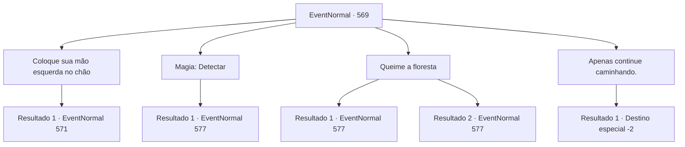

# Eventos normais · 569

[Índice da tabela](index.md) · [Índice geral](../index.md)

ID: `pt:EventNormal:569` · Fonte: `EventNormal4` · Versão: 1.2.47.

Mapeamento estático dos arquivos; a disponibilidade e a execução dependem do estado da run.

## Texto do evento

*Sem texto no arquivo.*

## Dados de entrada

```json
{
  "id": 569,
  "grade": 1,
  "place": "",
  "required": ""
}
```

## Mapa das escolhas



## Escolhas e resultados

### Escolha 1

Coloque sua mão esquerda no chão

Requisitos e outros campos da escolha:

```json
{
  "required": "5_638_1"
}
```

#### Resultado 1.1

Você coloca sua mão esquerda no chão como lhe foi dito, adentrando nas partes mais profundas da floresta. Logo, você vê uma árvore colossal e uma cabana que parece ter sido construída na árvore. Coberta de musgo e fungos, você começa a questionar se realmente um ser humano pode chamar aquilo de lar. Para sua surpresa, a porta da cabana se abre com força, e uma mulher muito idosa aparece. 

 "Hmm, um rosto novo. Me diga, o que esta velha senhora pode fazer por você?"

 A velha mulher te encara enquanto fala.

Continuação registrada: [Evento 571](0571.md) na mesma tabela.

```json
{
  "required": "",
  "chance": "1",
  "nextEvent": 571,
  "type": 2,
  "reward": ""
}
```

### Escolha 2

Magia: Detectar

Requisitos e outros campos da escolha:

```json
{
  "required": "20_0_1"
}
```

#### Resultado 2.1

Você detecta vestígios de magia espalhados pela floresta. Simplesmente infundindo-os com sua própria magia, você quebra o feitiço. Assim que você dissipar o efeito prejudicial, o som de vidro quebrando enche o ar, e você vê uma árvore colossal, juntamente com uma cabana que parece ter sido construída na árvore. Coberta de musgo e fungos, você começa a questionar se um ser humano realmente pode chamá-la de lar. Então, a porta da frente da cabana se abre com força, e uma mulher muito idosa aparece. <link=shake>

 "VOCÊ ARROGANTE, INGRATO PEQUENO BASTARDO!!! VOU LAVAR MEUS PÉS COM SEU COURO CABELUDO!"

</link> A velha grita com raiva, olhando fixamente para você. Logo, sua disfarce humano derrete, revelando sua verdadeira forma. Garras afiadas, pele enrugada e verde e coberta de tumores - uma bruxa verde.

Continuação registrada: [Evento 577](0577.md) na mesma tabela.

```json
{
  "required": "",
  "chance": "1",
  "nextEvent": 577,
  "type": 2,
  "reward": "6_0_130",
  "place": 1
}
```

### Escolha 3

Queime a floresta

Requisitos e outros campos da escolha:

```json
{
  "required": "-1|23_3_1|20_14_1"
}
```

#### Resultado 3.1

Você começa a conjurar magicamente uma parede de chamas. O fogo começa a queimar a árvore, emitindo fumaça preta. Mas logo, uma chuva começa a cair do céu, extinguindo o fogo. Ao mesmo tempo, você vê uma árvore colossal, junto com uma cabana que parece ter sido construída na árvore. Coberta de musgo e fungos, você começa a questionar se um ser humano realmente pode chamar aquilo de lar. Então, a porta da frente da cabana se abre com força, e uma mulher muito velha aparece. <link=shake>

 "VOCÊ ARROGANTE, INGRATO PEQUENO BASTARDO!!! Vou lavar meus pés com seu couro cabeludo!"

</link> A velha grita com raiva, olhando fixamente para você. Logo, sua disfarce humano se desfaz, revelando sua verdadeira forma. Garras afiadas, pele enrugada e verde e coberta de tumores - uma bruxa verde.

Continuação registrada: [Evento 577](0577.md) na mesma tabela.

```json
{
  "required": "20_0_3|1_1_2",
  "chance": "1",
  "nextEvent": 577,
  "type": 2,
  "reward": "6_0_130",
  "place": 1
}
```

#### Resultado 3.2

Você acende um fogo no meio da floresta. A lenha consome as árvores e se transforma em fogo, e depois em chamas enormes. Mas logo, uma chuva começa a cair do céu, apagando o fogo. Ao mesmo tempo, você vê uma árvore colossal, junto com uma cabana que parece ter sido construída na árvore. Coberta de musgo e fungos, você começa a questionar se um ser humano realmente pode chamar aquilo de lar. Então, a porta da frente da cabana se abre com força, e uma mulher muito velha aparece. <link=shake>

 "VOCÊ ARROGANTE, INGRATO PEQUENO BASTARDO!!! Vou lavar meus pés com seu couro cabeludo!"

</link> A velha grita com raiva, olhando fixamente para você. Logo, sua disfarce humano derrete, revelando sua verdadeira forma. Garras afiadas, pele enrugada e verde e coberta de tumores - uma bruxa verde.

Continuação registrada: [Evento 577](0577.md) na mesma tabela.

```json
{
  "required": "-1|21_0_3|2_1_2",
  "chance": "1",
  "nextEvent": 577,
  "type": 2,
  "reward": "6_2_130",
  "place": 1
}
```

### Escolha 4

Apenas continue caminhando.

Requisitos e outros campos da escolha:

```json
{
  "required": ""
}
```

#### Resultado 4.1

Você simplesmente continua caminhando. Mas não importa o quanto você tente alcançar a floresta profunda, você se encontra de volta exatamente onde começou. Ai de você, decide desistir de encontrar a bruxa verde, deixando a floresta para trás.

Continuação registrada: [Destino especial `-2`](../destinos-especiais.md).

```json
{
  "required": "",
  "chance": "1",
  "nextEvent": -2,
  "type": 2,
  "reward": "5_629_10"
}
```

## Referências que chegam a este evento

- [Evento 565 · escolha 4 · resultado 1](0565.md#escolha-4)
- [Evento 566 · escolha 2 · resultado 1](0566.md#escolha-2)
- [Evento 568 · escolha 1 · resultado 1](0568.md#escolha-1)
- [Evento 568 · escolha 2 · resultado 1](0568.md#escolha-2)
- [Evento 568 · escolha 3 · resultado 1](0568.md#escolha-3)
- [Evento 570 · escolha 1 · resultado 1](0570.md#escolha-1)
- [Evento 570 · escolha 2 · resultado 1](0570.md#escolha-2)
