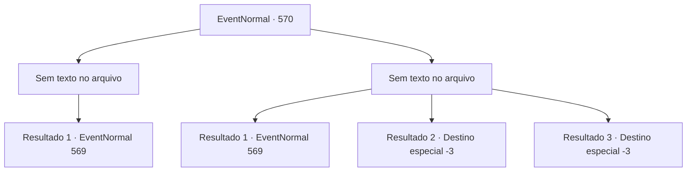

# Eventos normais · 570

[Índice da tabela](index.md) · [Índice geral](../index.md)

ID: `pt:EventNormal:570` · Fonte: `EventNormal4` · Versão: 1.2.47.

Mapeamento estático dos arquivos; a disponibilidade e a execução dependem do estado da run.

## Texto do evento

*Sem texto no arquivo.*

## Dados de entrada

```json
{
  "id": 570,
  "grade": 1,
  "place": "",
  "required": ""
}
```

## Mapa das escolhas



## Escolhas e resultados

### Escolha 1

*Sem texto no arquivo; o papel dessa opção depende da interface do jogo.*

Requisitos e outros campos da escolha:

```json
{
  "required": ""
}
```

#### Resultado 1.1

Nerev finalmente sucumbe à sua força. Você o deixa ir, e ele ofega por ar. 

 "Maldito... Você cabeça-quente...! Procure por uma cabana... no centro da floresta."

 Você se afasta do moinho de madeira e entra na floresta, em busca da bruxa. Assim que você entra, sente uma presença viscosa e pegajosa se enrolar em torno do seu corpo. Parece piorar à medida que você alcança as partes mais profundas da floresta. Depois de alguns minutos de caminhada, você percebe que está de volta onde começou. É como se a própria floresta estivesse determinada a te confundir.

Continuação registrada: [Evento 569](0569.md) na mesma tabela.

```json
{
  "required": "",
  "chance": "1",
  "nextEvent": 569,
  "type": 2,
  "reward": ""
}
```

### Escolha 2

*Sem texto no arquivo; o papel dessa opção depende da interface do jogo.*

Requisitos e outros campos da escolha:

```json
{
  "required": ""
}
```

#### Resultado 2.1

Você mal consegue escapar dos ataques do lenhador. Sem mais maneiras de obter informações, você decide simplesmente entrar na floresta. Assim que você entra, você sente uma presença viscosa e pegajosa se enrolar em torno do seu corpo. Parece piorar à medida que você alcança as partes mais profundas da floresta. Depois de alguns minutos de caminhada, você percebe que está de volta ao ponto de partida. É como se a própria floresta estivesse determinada a te confundir.

Continuação registrada: [Evento 569](0569.md) na mesma tabela.

```json
{
  "required": "1_0_2|1_1_2",
  "chance": "1",
  "nextEvent": 569,
  "type": 2,
  "reward": "0_0_-1|0_1_-1"
}
```

#### Resultado 2.2

O machado do lenhador encontra seu caminho em seu crânio, rachando-o ao meio. 

 "Uh... maldito...!"

 Praguejando e xingando é a última coisa que você ouve, enquanto sua consciência desaparece na escuridão.

Continuação registrada: [Destino especial `-3`](../destinos-especiais.md).

```json
{
  "required": "2_0_2",
  "chance": "1",
  "nextEvent": -3,
  "type": 2,
  "reward": "0_0_-1|0_1_-1"
}
```

#### Resultado 2.3

O machado do lenhador encontra seu caminho em seu crânio, rachando-o ao meio. 

 "Uh... maldito...!"

 Praguejando e xingando é a última coisa que você ouve, enquanto sua consciência desaparece na escuridão.

Continuação registrada: [Destino especial `-3`](../destinos-especiais.md).

```json
{
  "required": "2_1_2",
  "chance": "1",
  "nextEvent": -3,
  "type": 2,
  "reward": "0_0_-1|0_1_-1"
}
```

## Referências que chegam a este evento

- [Evento 568 · escolha 2 · resultado 2](0568.md#escolha-2)
