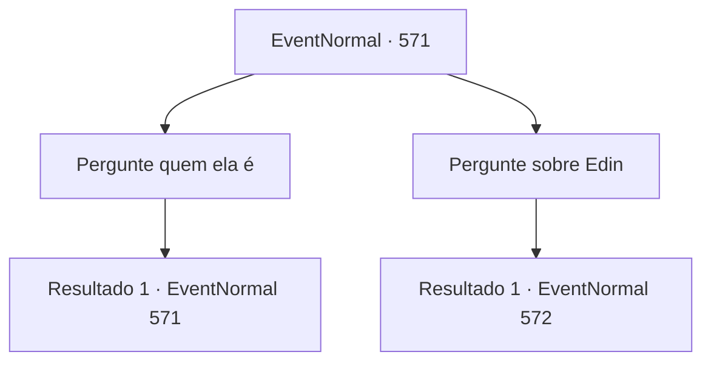

# Eventos normais · 571

[Índice da tabela](index.md) · [Índice geral](../index.md)

ID: `pt:EventNormal:571` · Fonte: `EventNormal4` · Versão: 1.2.47.

Mapeamento estático dos arquivos; a disponibilidade e a execução dependem do estado da run.

## Texto do evento

*Sem texto no arquivo.*

## Dados de entrada

```json
{
  "id": 571,
  "grade": 1,
  "place": "",
  "required": ""
}
```

## Mapa das escolhas



## Escolhas e resultados

### Escolha 1

Pergunte quem ela é

Requisitos e outros campos da escolha:

```json
{
  "required": "5_639_0"
}
```

#### Resultado 1.1

Você exige que a velha revele quem ela é. Ela simplesmente abre os braços em resposta. 

 "Você pode me chamar... a guardiã desta floresta. Suponho que você está satisfeito com minha resposta? Agora, é minha vez, então. Por que você está me procurando? Seja um bom menino, agora. Esta vovó não é muito paciente."


Continuação registrada: [Evento 571](0571.md) na mesma tabela.

```json
{
  "required": "",
  "chance": "1",
  "nextEvent": 571,
  "type": 2,
  "reward": "5_639_1"
}
```

### Escolha 2

Pergunte sobre Edin

Requisitos e outros campos da escolha:

```json
{
  "required": ""
}
```

#### Resultado 2.1

Você questiona a velha sobre Edin. Ela responde balançando o dedo indicador. 

 "Criança. Já ouviu falar de olho por olho? Quando você me pergunta algo, eu peço algo em troca... Então me diga. O que você pode me dar?"


Continuação registrada: [Evento 572](0572.md) na mesma tabela.

```json
{
  "required": "",
  "chance": "1",
  "nextEvent": 572,
  "type": 2,
  "reward": ""
}
```

## Referências que chegam a este evento

- [Evento 569 · escolha 1 · resultado 1](0569.md#escolha-1)
- [Evento 571 · escolha 1 · resultado 1](0571.md#escolha-1)
