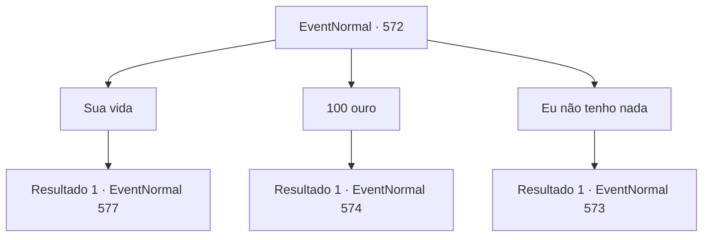

# Eventos normais · 572

[Índice da tabela](index.md) · [Índice geral](../index.md)

ID: `pt:EventNormal:572` · Fonte: `EventNormal4` · Versão: 1.2.47.

Mapeamento estático dos arquivos; a disponibilidade e a execução dependem do estado da run.

## Texto do evento

*Sem texto no arquivo.*

## Dados de entrada

```json
{
  "id": 572,
  "grade": 1,
  "place": "",
  "required": ""
}
```

## Mapa das escolhas



## Escolhas e resultados

### Escolha 1

Sua vida

Requisitos e outros campos da escolha:

```json
{
  "required": "2_3_-14"
}
```

#### Resultado 1.1

Sua resposta enfurece a velha mulher. As rugas em sua testa se intensificam, e sua voz estridente bate contra seus tímpanos. <link=shake>

 "VOCÊ ARROGANTE, INGRATO PEQUENO BASTARDO!!! EU VOU LAVAR MEUS PÉS COM SEU COURO CABELUDO!"

</link> A velha mulher grita com raiva, olhando fixamente para você. Logo, sua disfarce humano derrete, revelando sua verdadeira forma. Garras afiadas, pele enrugada e verde e coberta de tumores - uma bruxa verde.

Continuação registrada: [Evento 577](0577.md) na mesma tabela.

```json
{
  "required": "",
  "chance": "1",
  "nextEvent": 577,
  "type": 2,
  "reward": "6_3_130",
  "place": 1
}
```

### Escolha 2

100 ouro

Requisitos e outros campos da escolha:

```json
{
  "required": "1_4_100"
}
```

#### Resultado 2.1

A velha mulher considera sua oferta por um momento antes de assentir. 

 "Suponho que isso serviria. Certo, agora... Quem era? Edin? Viola? Seja lá quem for, é basicamente a mesma história. Vou te contar."

 A velha mulher se senta em uma cadeira de madeira. Ela então coloca uma xícara de chá em seu colo e continua. 

 "Bem, você vai ficar aí parado? Vamos lá, sente-se."


Continuação registrada: [Evento 574](0574.md) na mesma tabela.

```json
{
  "required": "",
  "chance": "1",
  "nextEvent": 574,
  "type": 2,
  "reward": "0_4_-100"
}
```

### Escolha 3

Eu não tenho nada

Requisitos e outros campos da escolha:

```json
{
  "required": ""
}
```

#### Resultado 3.1

A velha responde com um longo suspiro. 

 "...O que você está insinuando? Que eu faça isso de graça? Nunca vai acontecer. Nunca, nunca, nunca. Vamos ver aqui..."

 A velha busca em suas prateleiras e retorna com uma pequena noz. Ela joga na sua frente e continua. 

 "Aí está. Quebre a noz."


Continuação registrada: [Evento 573](0573.md) na mesma tabela.

```json
{
  "required": "",
  "chance": "1",
  "nextEvent": 573,
  "type": 2,
  "reward": ""
}
```

## Referências que chegam a este evento

- [Evento 571 · escolha 2 · resultado 1](0571.md#escolha-2)
