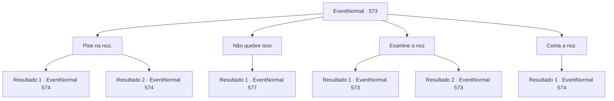

# Eventos normais · 573

[Índice da tabela](index.md) · [Índice geral](../index.md)

ID: `pt:EventNormal:573` · Fonte: `EventNormal4` · Versão: 1.2.47.

Mapeamento estático dos arquivos; a disponibilidade e a execução dependem do estado da run.

## Texto do evento

*Sem texto no arquivo.*

## Dados de entrada

```json
{
  "id": 573,
  "grade": 1,
  "place": "",
  "required": ""
}
```

## Mapa das escolhas



## Escolhas e resultados

### Escolha 1

Pise na noz.

Requisitos e outros campos da escolha:

```json
{
  "required": ""
}
```

#### Resultado 1.1

Você faz o que lhe mandam, pisando na noz e esmagando-a com seu peso. A velha sorri satisfeita. 

 "Bom, bom. Isso é o que acontece com os pequenos malvados que não ouvem a vovó. Certo, agora... Quem era? Edin? Viola? Seja lá quem for, é basicamente a mesma história. Vou te contar."

 A velha se senta em uma cadeira de madeira. Ela então coloca uma xícara de chá em seu colo e continua. 

 "Bem, você vai ficar aí parado? Vamos lá, sente-se."


Continuação registrada: [Evento 574](0574.md) na mesma tabela.

```json
{
  "required": "18_640_1",
  "chance": "1",
  "nextEvent": 574,
  "type": 2,
  "reward": "5_641_1"
}
```

#### Resultado 1.2

Você faz o que lhe mandam, pisando na noz e esmagando-a com seu peso. A velha sorri satisfeita. 

 "Bom, bom. Isso é o que acontece com os pequenos malvados que não ouvem a vovó. Certo, agora... Quem era? Edin? Viola? Seja lá quem for, é basicamente a mesma história. Vou te contar."

 A velha se senta em uma cadeira de madeira. Ela então coloca uma xícara de chá em seu colo e continua. 

 "Bem, você vai ficar aí parado? Vamos lá, sente-se."


Continuação registrada: [Evento 574](0574.md) na mesma tabela.

```json
{
  "required": "5_640_1",
  "chance": "1",
  "nextEvent": 574,
  "type": 2,
  "reward": "5_641_1|0_3_-5"
}
```

### Escolha 2

Não quebre isso

Requisitos e outros campos da escolha:

```json
{
  "required": ""
}
```

#### Resultado 2.1

Em vez de esmagar a noz, você a pega do chão e coloca nos bolsos. A velha franze a testa em resposta. 

 "...O que você está fazendo? Parece que preciso te ensinar uma lição para não mexer com a vovó!"

 A velha grita com raiva, olhando fixamente para você. Logo, sua disfarce humano se desfaz, revelando sua verdadeira forma. Garras afiadas, pele enrugada e verde e coberta de tumores - uma bruxa verde.

Continuação registrada: [Evento 577](0577.md) na mesma tabela.

```json
{
  "required": "",
  "chance": "1",
  "nextEvent": 577,
  "type": 2,
  "reward": "6_3_130",
  "place": 1
}
```

### Escolha 3

Examine a noz

Requisitos e outros campos da escolha:

```json
{
  "required": "5_640_0"
}
```

#### Resultado 3.1

Você examina cuidadosamente a noz no chão. Logo, você percebe que ela está impregnada de magia. Você também encontra as letras 'N-E-R-E-V' escritas nela. O feitiço vincula a noz a Nerev - prejudicar a noz de qualquer maneira certamente afetará Nerev também. 

 "Por que você está olhando assim? Está com fome, talvez?"

 Zombando, a velha continua a te provocar para quebrar a noz.

Continuação registrada: [Evento 573](0573.md) na mesma tabela.

```json
{
  "required": "",
  "chance": "1|0_14_1|0_7_1",
  "nextEvent": 573,
  "type": 0,
  "reward": "5_640_1"
}
```

#### Resultado 3.2

Você examina cuidadosamente a noz no chão. Mas a noz parece simples e normal - você não consegue encontrar nada de significativo.

Continuação registrada: [Evento 573](0573.md) na mesma tabela.

```json
{
  "required": "",
  "chance": "22",
  "nextEvent": 573,
  "type": 1,
  "reward": "5_640_2"
}
```

### Escolha 4

Coma a noz.

Requisitos e outros campos da escolha:

```json
{
  "required": "18_640_0"
}
```

#### Resultado 4.1

Você pega a noz do chão, engolindo-a inteira. A velha começa a gargalhar. 

 "Ahahaha! HAHAHAHAHA! Isso funciona, eu acho. Isso é o que acontece com os pequenos malvados que não ouvem a vovó. Certo, agora... Quem era? Edin? Viola? Seja lá quem for, é basicamente a mesma história. Vou te contar."

 A velha se senta em uma cadeira de madeira. Ela então coloca uma xícara de chá em seu colo e continua. 

 "Bem, você vai ficar aí parado? Vamos lá, sente-se."


Continuação registrada: [Evento 574](0574.md) na mesma tabela.

```json
{
  "required": "",
  "chance": "1",
  "nextEvent": 574,
  "type": 2,
  "reward": "0_7_1|0_3_-5|5_641_1"
}
```

## Referências que chegam a este evento

- [Evento 572 · escolha 3 · resultado 1](0572.md#escolha-3)
- [Evento 573 · escolha 3 · resultado 1](0573.md#escolha-3)
- [Evento 573 · escolha 3 · resultado 2](0573.md#escolha-3)
