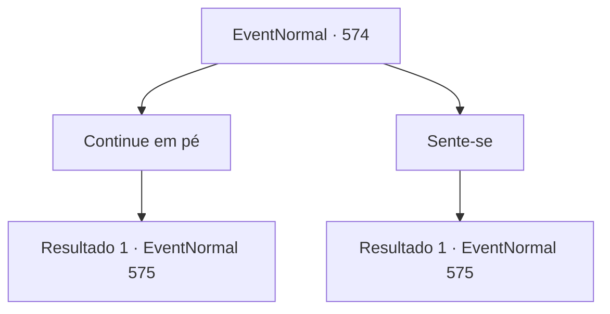

# Eventos normais · 574

[Índice da tabela](index.md) · [Índice geral](../index.md)

ID: `pt:EventNormal:574` · Fonte: `EventNormal4` · Versão: 1.2.47.

Mapeamento estático dos arquivos; a disponibilidade e a execução dependem do estado da run.

## Texto do evento

*Sem texto no arquivo.*

## Dados de entrada

```json
{
  "id": 574,
  "grade": 1,
  "place": "",
  "required": ""
}
```

## Mapa das escolhas



## Escolhas e resultados

### Escolha 1

Continue em pé

Requisitos e outros campos da escolha:

```json
{
  "required": ""
}
```

#### Resultado 1.1


 "Eu não te disse que prefiro crianças bem-comportadas...? Ah, tanto faz. Você está perdoado desta vez."

 A velha mulher sorve sua xícara de chá e continua. Você consegue sentir o cheiro do chá daqui - gosto amargo. 

 "Edin amava Viola com todo o seu coração. Ele não queria que ninguém a tirasse dele. Um amor tão intenso ele sentia...! Foi o suficiente para fazer o coração de uma velha mulher doer. Então Edin veio até mim um dia, implorando, 'Vovó, eu desejo que Viola olhe para mim, e somente para mim'."

 Ela dá de ombros, e continua. 

 "Foi isso que eu fiz. Fiz Viola olhar para Edin. Para sempre."


Continuação registrada: [Evento 575](0575.md) na mesma tabela.

```json
{
  "required": "",
  "chance": "1",
  "nextEvent": 575,
  "type": 2,
  "reward": ""
}
```

### Escolha 2

Sente-se

Requisitos e outros campos da escolha:

```json
{
  "required": ""
}
```

#### Resultado 2.1

Você decide ficar sentado enquanto a velha mulher fala. A velha mulher sorve sua xícara de chá e continua. Você consegue sentir o cheiro do chá daqui - gosto amargo. 

 "Edin amava Viola com todo o seu coração. Ele não queria que ninguém a tirasse dele. Um amor tão intenso que ele sentia...! Era o suficiente para fazer o coração de uma velha mulher doer. Então Edin veio até mim um dia, implorando, 'Vovó, eu desejo que Viola olhe para mim, e somente para mim'."

 Ela dá de ombros, e continua. 

 "Foi isso que eu fiz. Fiz Viola olhar para Edin. Para sempre."


Continuação registrada: [Evento 575](0575.md) na mesma tabela.

```json
{
  "required": "",
  "chance": "1",
  "nextEvent": 575,
  "type": 2,
  "reward": ""
}
```

## Referências que chegam a este evento

- [Evento 572 · escolha 2 · resultado 1](0572.md#escolha-2)
- [Evento 573 · escolha 1 · resultado 1](0573.md#escolha-1)
- [Evento 573 · escolha 1 · resultado 2](0573.md#escolha-1)
- [Evento 573 · escolha 4 · resultado 1](0573.md#escolha-4)
