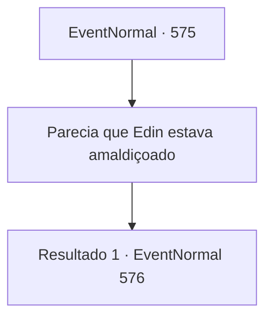

# Eventos normais · 575

[Índice da tabela](index.md) · [Índice geral](../index.md)

ID: `pt:EventNormal:575` · Fonte: `EventNormal4` · Versão: 1.2.47.

Mapeamento estático dos arquivos; a disponibilidade e a execução dependem do estado da run.

## Texto do evento

*Sem texto no arquivo.*

## Dados de entrada

```json
{
  "id": 575,
  "grade": 1,
  "place": "",
  "required": ""
}
```

## Mapa das escolhas



## Escolhas e resultados

### Escolha 1

Parecia que Edin estava amaldiçoado

Requisitos e outros campos da escolha:

```json
{
  "required": ""
}
```

#### Resultado 1.1

A velha dá outro gole e continua.. 

 "Amaldiçoado? Como assim, isso não pode ser! Ele pode estar com sua amada Viola o dia todo, todos os dias! Como você chamaria isso de maldição?! Meu Deus, essas crianças de hoje em dia são tão... ingratos, não são?"

 A velha franze a testa e expressa seu desconforto. 

 "Ainda me lembro dele, chorando e implorando como um bebê, como se fosse ontem. *clique*... Procure no porão de sua casa. Lá você encontrará uma lanterna. Queime a lanterna, e ele nunca mais poderá vê-la novamente."


Continuação registrada: [Evento 576](0576.md) na mesma tabela.

```json
{
  "required": "",
  "chance": "1",
  "nextEvent": 576,
  "type": 2,
  "reward": ""
}
```

## Referências que chegam a este evento

- [Evento 574 · escolha 1 · resultado 1](0574.md#escolha-1)
- [Evento 574 · escolha 2 · resultado 1](0574.md#escolha-2)
