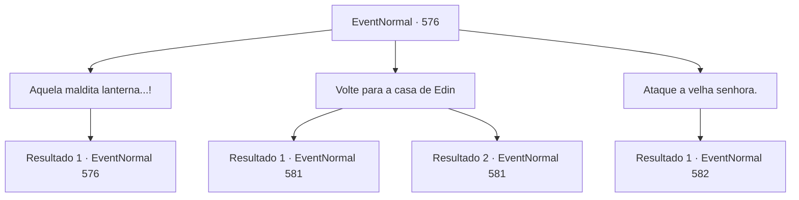

# Eventos normais · 576

[Índice da tabela](index.md) · [Índice geral](../index.md)

ID: `pt:EventNormal:576` · Fonte: `EventNormal4` · Versão: 1.2.47.

Mapeamento estático dos arquivos; a disponibilidade e a execução dependem do estado da run.

## Texto do evento

*Sem texto no arquivo.*

## Dados de entrada

```json
{
  "id": 576,
  "grade": 1,
  "place": "",
  "required": ""
}
```

## Mapa das escolhas



## Escolhas e resultados

### Escolha 1

Aquela maldita lanterna...!

Requisitos e outros campos da escolha:

```json
{
  "required": "5_634_1"
}
```

#### Resultado 1.1

Você se lembra de ter encontrado a lanterna horrível no porão. A coisa com a cabeça decepada de Viola dentro dela. A velha te lança um olhar. 

 "Ah, você deve ter encontrado ela já. Você vai entender rapidamente, então. Essa é a tal. A lanterna com a cabeça de Viola dentro. Vá em frente e queime."


Continuação registrada: [Evento 576](0576.md) na mesma tabela.

```json
{
  "required": "",
  "chance": "1",
  "nextEvent": 576,
  "type": 2,
  "reward": "5_634_2"
}
```

### Escolha 2

Volte para a casa de Edin

Requisitos e outros campos da escolha:

```json
{
  "required": ""
}
```

#### Resultado 2.1

Você volta para a casa de Edin. Irene te vê chegando de dentro e rapidamente abre a porta para te cumprimentar. 

 "Encontrou alguma coisa?"

 Você corre para o porão, pega a lanterna e corre para a cozinha. A cabeça de Viola, embora desidratada, parece estar emitindo um lamento arrepiante. É quando você encontra Edin, saindo apressado de seu quarto, tentando te impedir. 

 "P...pare! Viola! Essa é minha Viola! Não encoste um dedo nela!!"


Continuação registrada: [Evento 581](0581.md) na mesma tabela.

```json
{
  "required": "18_641_1",
  "chance": "1",
  "nextEvent": 581,
  "type": 2,
  "reward": ""
}
```

#### Resultado 2.2

Você sai rapidamente da floresta. No caminho para a casa de Edin, você se depara com Nerev, deitado no chão. Você percebe que ele está espumando - já sem vida. Você passa por ele, chegando à casa de Edin. Irene te vê chegando de dentro e rapidamente abre a porta para cumprimentá-lo. 

 "Encontrou alguma coisa?"

 Você corre para o porão, pega a lanterna e corre para a cozinha. A cabeça de Viola, embora ressecada, parece estar emitindo um lamento arrepiante. É quando você encontra Edin, saindo apressado de seu quarto, tentando impedi-lo. 

 "P...pare! Viola! Essa é minha Viola! Não encoste um dedo nela!!"


Continuação registrada: [Evento 581](0581.md) na mesma tabela.

```json
{
  "required": "5_641_1",
  "chance": "1",
  "nextEvent": 581,
  "type": 2,
  "reward": ""
}
```

### Escolha 3

Ataque a velha senhora.

Requisitos e outros campos da escolha:

```json
{
  "required": "5_634_2"
}
```

#### Resultado 3.1

Você ataca a velha. Ela dá um passo para trás e logo revela sua verdadeira identidade. <link=shake>

 "VOCÊ ARROGANTE, INGRATO PEQUENO BASTARDO!!! Vou lavar meus pés com seu couro cabeludo!"

</link> Garras afiadas, pele enrugada e verde e coberta de tumores - uma bruxa verde.

Continuação registrada: [Evento 582](0582.md) na mesma tabela.

```json
{
  "required": "",
  "chance": "1",
  "nextEvent": 582,
  "type": 2,
  "reward": "6_0_130",
  "place": 1
}
```

## Referências que chegam a este evento

- [Evento 575 · escolha 1 · resultado 1](0575.md#escolha-1)
- [Evento 576 · escolha 1 · resultado 1](0576.md#escolha-1)
