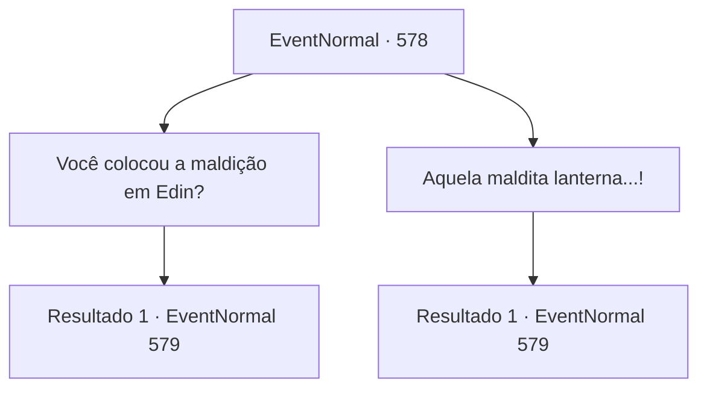

# Eventos normais · 578

[Índice da tabela](index.md) · [Índice geral](../index.md)

ID: `pt:EventNormal:578` · Fonte: `EventNormal4` · Versão: 1.2.47.

Mapeamento estático dos arquivos; a disponibilidade e a execução dependem do estado da run.

## Texto do evento

*Sem texto no arquivo.*

## Dados de entrada

```json
{
  "id": 578,
  "grade": 1,
  "place": "",
  "required": ""
}
```

## Mapa das escolhas



## Escolhas e resultados

### Escolha 1

Você colocou a maldição em Edin?

Requisitos e outros campos da escolha:

```json
{
  "required": ""
}
```

#### Resultado 1.1


 "Amaldiçoado? Ele tem a oportunidade de ver sua amada Viola todos os dias, e chama isso de maldição? Ah, é exatamente por isso que você não ajuda essas bestas de cabelos pretos..."

 A bruxa franze a testa, expressando seu desconforto. 

 "Ainda me lembro dele, chorando e implorando como um bebê, como se fosse ontem. *clique*... Procure no porão de sua casa. Lá você encontrará uma lanterna. Queime a lanterna, e ele nunca mais será capaz de vê-la novamente."


Continuação registrada: [Evento 579](0579.md) na mesma tabela.

```json
{
  "required": "",
  "chance": "1",
  "nextEvent": 579,
  "type": 2,
  "reward": ""
}
```

### Escolha 2

Aquela maldita lanterna...!

Requisitos e outros campos da escolha:

```json
{
  "required": "5_634_1"
}
```

#### Resultado 2.1

Você se lembra de ter encontrado a lanterna horrível no porão. A coisa com a cabeça decepada de Viola dentro dela. A bruxa percebe sua expressão. 

 "Ah, você deve tê-la encontrado já. Você vai entender rapidamente, então. Essa é a única. A lanterna com a cabeça de Viola dentro. Vá em frente e queime-a."


Continuação registrada: [Evento 579](0579.md) na mesma tabela.

```json
{
  "required": "",
  "chance": "1",
  "nextEvent": 579,
  "type": 2,
  "reward": ""
}
```

## Referências que chegam a este evento

- [Evento 577 · escolha 1 · resultado 1](0577.md#escolha-1)
