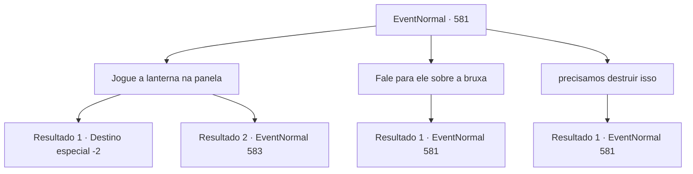

# Eventos normais · 581

[Índice da tabela](index.md) · [Índice geral](../index.md)

ID: `pt:EventNormal:581` · Fonte: `EventNormal4` · Versão: 1.2.47.

Mapeamento estático dos arquivos; a disponibilidade e a execução dependem do estado da run.

## Texto do evento

*Sem texto no arquivo.*

## Dados de entrada

```json
{
  "id": 581,
  "grade": 1,
  "place": "",
  "required": ""
}
```

## Mapa das escolhas



## Escolhas e resultados

### Escolha 1

Jogue a lanterna na panela

Requisitos e outros campos da escolha:

```json
{
  "required": "5_643_2"
}
```

#### Resultado 1.1

Assim que você joga a lanterna na panela, ela começa a queimar. A próxima coisa que você ouve é o horrível grito estridente - vindo da boca de Edin. De repente, a cabeça de Edin se incendeia. <link=shake>

 "GAAAAAAAARGH...!! aaAaaahh!!!"

</link> Você rapidamente joga um pouco de água nele, mas simplesmente não consegue apagar o fogo. Assistindo à cena se desenrolar, Irene desmaia. O fogo só termina depois de queimar a cabeça de Edin. Você cuidadosamente sai da casa de Irene. Mesmo tarde, você tenta ir atrás da bruxa mais uma vez, mas o covil da bruxa já desapareceu.

Continuação registrada: [Destino especial `-2`](../destinos-especiais.md).

```json
{
  "required": "18_642_1",
  "chance": "1",
  "nextEvent": -2,
  "type": 2,
  "reward": "5_629_10"
}
```

#### Resultado 1.2

Assim que você joga a lanterna na panela, o vidro se quebra, e a cabeça de Viola começa a queimar. Edin tenta tirá-la da panela, mas Irene consegue impedi-lo. 

 "Recupere-se, meu garoto...!! Isso não é você!!"

 Edin continua se debatendo, gritando o nome de Viola várias vezes, antes de finalmente perder a consciência. Irene se senta no chão para recuperar o fôlego, exausta. 

 "Ufa... Meu filho vai ficar bem a partir de agora, certo...?"

 Ela agradece por tudo que você fez por Edin, e concorda em deixar você pegar o que quiser de sua casa.

Continuação registrada: [Evento 583](0583.md) na mesma tabela.

```json
{
  "required": "5_642_1",
  "chance": "1",
  "nextEvent": 583,
  "type": 2,
  "reward": ""
}
```

### Escolha 2

Fale para ele sobre a bruxa

Requisitos e outros campos da escolha:

```json
{
  "required": "5_643_0"
}
```

#### Resultado 2.1

Você pergunta a Edin se ele sabe sobre bruxas. Ele acena com a cabeça em resposta. 

 "Sim. A guardiã da floresta... Eu implorei a ela, para fazer Viola olhar para mim. Ela me disse que... ela pode fazer isso acontecer, em troca do meu olho direito. Eu... eu dei a ela o que ela queria, sem hesitação."

 Ele ainda parece nervoso, mas continua. 

 "Alguns dias depois, a bruxa me entregou a lanterna. Disse-me que Viola vai olhar para mim para sempre a partir de agora. E depois disso... tive visões e continuei ouvindo a voz de Viola... chorando, lamentando, lamentando..."

 Ouvindo tudo isso, Irene coloca a mão na testa e se encosta em uma parede próxima.

Continuação registrada: [Evento 581](0581.md) na mesma tabela.

```json
{
  "required": "",
  "chance": "1",
  "nextEvent": 581,
  "type": 2,
  "reward": "5_643_1"
}
```

### Escolha 3

precisamos destruir isso

Requisitos e outros campos da escolha:

```json
{
  "required": "5_643_1"
}
```

#### Resultado 3.1

Você entrega o que a bruxa disse a ele. Que a única maneira de libertar Edin das alucinações é queimar a lanterna. Ele balança a cabeça em resposta. 

 "N-não... Eu não posso. Eu não consigo viver sem essa lanterna."


Continuação registrada: [Evento 581](0581.md) na mesma tabela.

```json
{
  "required": "",
  "chance": "1",
  "nextEvent": 581,
  "type": 2,
  "reward": "5_643_2"
}
```

## Referências que chegam a este evento

- [Evento 576 · escolha 2 · resultado 1](0576.md#escolha-2)
- [Evento 576 · escolha 2 · resultado 2](0576.md#escolha-2)
- [Evento 579 · escolha 1 · resultado 1](0579.md#escolha-1)
- [Evento 580 · escolha 1 · resultado 1](0580.md#escolha-1)
- [Evento 580 · escolha 2 · resultado 1](0580.md#escolha-2)
- [Evento 581 · escolha 2 · resultado 1](0581.md#escolha-2)
- [Evento 581 · escolha 3 · resultado 1](0581.md#escolha-3)
- [Evento 582 · escolha 2 · resultado 1](0582.md#escolha-2)
