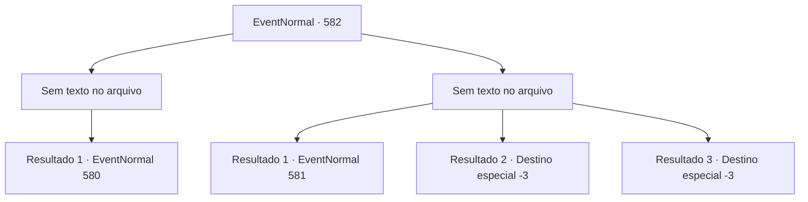

# Eventos normais · 582

[Índice da tabela](index.md) · [Índice geral](../index.md)

ID: `pt:EventNormal:582` · Fonte: `EventNormal4` · Versão: 1.2.47.

Mapeamento estático dos arquivos; a disponibilidade e a execução dependem do estado da run.

## Texto do evento

*Sem texto no arquivo.*

## Dados de entrada

```json
{
  "id": 582,
  "grade": 1,
  "place": "",
  "required": ""
}
```

## Mapa das escolhas



## Escolhas e resultados

### Escolha 1

*Sem texto no arquivo; o papel dessa opção depende da interface do jogo.*

Requisitos e outros campos da escolha:

```json
{
  "required": ""
}
```

#### Resultado 1.1

A bruxa está sobrecarregada com o seu poder. Ela grita desesperadamente para você, tentando se arrastar para longe. 

 "P- pense sobre isso mais uma vez! Sem mim, a floresta desaparecerá! Você está roubando os moradores da cidade de sua cidade natal! Isso não é da sua conta, aventureiro!"


Continuação registrada: [Evento 580](0580.md) na mesma tabela.

```json
{
  "required": "",
  "chance": "1",
  "nextEvent": 580,
  "type": 2,
  "reward": ""
}
```

### Escolha 2

*Sem texto no arquivo; o papel dessa opção depende da interface do jogo.*

Requisitos e outros campos da escolha:

```json
{
  "required": ""
}
```

#### Resultado 2.1

Depois de mal sobreviver aos ataques da bruxa, você foge da floresta. Você volta para a casa de Edin. Irene te vê chegando de dentro e rapidamente abre a porta para te cumprimentar. 

 "Encontrou alguma coisa?"

 Você corre para o porão, pega a lanterna e corre para a cozinha. A cabeça de Viola, embora desidratada, parece estar emitindo um lamento arrepiante. É quando você encontra Edin, saindo apressado do quarto, tentando te impedir. 

 "P...pare! Viola! Essa é minha Viola! Não encoste um dedo nela!!"


Continuação registrada: [Evento 581](0581.md) na mesma tabela.

```json
{
  "required": "1_0_2|1_1_2",
  "chance": "1",
  "nextEvent": 581,
  "type": 2,
  "reward": "0_0_-1|0_1_-1"
}
```

#### Resultado 2.2

A bruxa acaba sendo uma mulher de palavra. Sua vida é tirada pela bruxa verde, e seu couro cabeludo se torna a mais nova toalha para os pés dela.

Continuação registrada: [Destino especial `-3`](../destinos-especiais.md).

```json
{
  "required": "2_0_2",
  "chance": "1",
  "nextEvent": -3,
  "type": 2,
  "reward": "0_0_-1|0_1_-1"
}
```

#### Resultado 2.3

A bruxa acaba sendo uma mulher de palavra. Sua vida é tirada pela bruxa verde, e seu couro cabeludo se torna a mais nova toalha para os pés dela.

Continuação registrada: [Destino especial `-3`](../destinos-especiais.md).

```json
{
  "required": "2_1_2",
  "chance": "1",
  "nextEvent": -3,
  "type": 2,
  "reward": "0_0_-1|0_1_-1"
}
```

## Referências que chegam a este evento

- [Evento 576 · escolha 3 · resultado 1](0576.md#escolha-3)
