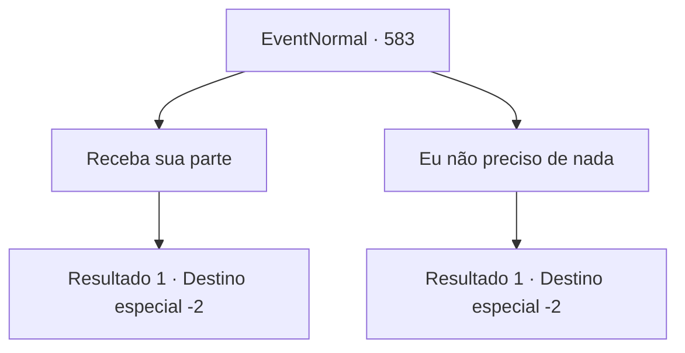

# Eventos normais · 583

[Índice da tabela](index.md) · [Índice geral](../index.md)

ID: `pt:EventNormal:583` · Fonte: `EventNormal4` · Versão: 1.2.47.

Mapeamento estático dos arquivos; a disponibilidade e a execução dependem do estado da run.

## Texto do evento

*Sem texto no arquivo.*

## Dados de entrada

```json
{
  "id": 583,
  "grade": 1,
  "place": "",
  "required": ""
}
```

## Mapa das escolhas



## Escolhas e resultados

### Escolha 1

Receba sua parte

Requisitos e outros campos da escolha:

```json
{
  "required": ""
}
```

#### Resultado 1.1

Você revira o lugar desarrumado, juntando peixes, batatas e algumas moedas de ouro. Irene levou Edin para a cama. Ele ainda parece estar suando muito. Ela te agradece várias vezes pela ajuda, e te acompanha até a saída enquanto você deixa a cidade.

Continuação registrada: [Destino especial `-2`](../destinos-especiais.md).

```json
{
  "required": "",
  "chance": "1",
  "nextEvent": -2,
  "type": 2,
  "reward": "5_629_10|0_4_10|3_137_1|3_125_1"
}
```

### Escolha 2

Eu não preciso de nada

Requisitos e outros campos da escolha:

```json
{
  "required": ""
}
```

#### Resultado 2.1

Você diz a ela que não vai pegar nada dela. Irene levou Edin para a cama. Ele ainda parece estar suando muito. Ela te agradece várias vezes pela ajuda e te acompanha até a saída enquanto você deixa a cidade.

Continuação registrada: [Destino especial `-2`](../destinos-especiais.md).

```json
{
  "required": "",
  "chance": "1",
  "nextEvent": -2,
  "type": 2,
  "reward": "5_629_10"
}
```

## Referências que chegam a este evento

- [Evento 581 · escolha 1 · resultado 2](0581.md#escolha-1)
