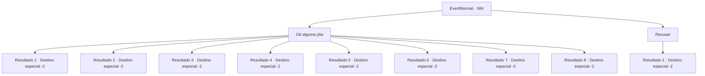

# Eventos normais · 584

[Índice da tabela](index.md) · [Índice geral](../index.md)

ID: `pt:EventNormal:584` · Fonte: `EventNormal4` · Versão: 1.2.47.

Mapeamento estático dos arquivos; a disponibilidade e a execução dependem do estado da run.

## Texto do evento

A menininha que você conheceu da última vez se aproxima de você e puxa sua manga. A criança olha para você novamente e pede por suas joias. 

 "Aventureiro! Eu estive esperando! Desta vez, vou te dar algo ainda melhor do que da última vez!"


## Dados de entrada

```json
{
  "id": 584,
  "grade": 1,
  "place": "",
  "required": "5_626_1"
}
```

## Mapa das escolhas



## Escolhas e resultados

### Escolha 1

Dê alguma jóia

Requisitos e outros campos da escolha:

```json
{
  "required": "17_0_2"
}
```

#### Resultado 1.1

Ela sorri brilhantemente e diz obrigada. Então ela tira algo do bolso e estende para fora. 

 "Espero que isso ajude! Até mais, então!"

 Ela coloca sua joia na boca, mastiga e se afasta.

Continuação registrada: [Destino especial `-2`](../destinos-especiais.md).

```json
{
  "required": "",
  "chance": "1",
  "nextEvent": -2,
  "type": 2,
  "reward": "0_2_1|3_52_1|5_626_9"
}
```

#### Resultado 1.2

Ela sorri brilhantemente e diz obrigada. Então ela tira algo do bolso e estende para fora. 

 "Espero que isso ajude! Até mais, então!"

 Ela coloca sua joia na boca, mastiga e se afasta.

Continuação registrada: [Destino especial `-2`](../destinos-especiais.md).

```json
{
  "required": "",
  "chance": "1",
  "nextEvent": -2,
  "type": 2,
  "reward": "0_2_1|3_99_1|5_626_9"
}
```

#### Resultado 1.3

Ela sorri brilhantemente e diz obrigada. Então ela tira algo do bolso e estende para fora. 

 "Espero que isso ajude! Até mais, então!"

 Ela coloca sua joia na boca, mastiga e se afasta.

Continuação registrada: [Destino especial `-2`](../destinos-especiais.md).

```json
{
  "required": "",
  "chance": "1",
  "nextEvent": -2,
  "type": 2,
  "reward": "0_2_1|3_201_1|5_626_9"
}
```

#### Resultado 1.4

Ela sorri brilhantemente e diz obrigada. Então ela tira algo do bolso e estende para fora. 

 "Espero que isso ajude! Até mais, então!"

 Ela coloca sua joia na boca, mastiga e se afasta.

Continuação registrada: [Destino especial `-2`](../destinos-especiais.md).

```json
{
  "required": "",
  "chance": "1",
  "nextEvent": -2,
  "type": 2,
  "reward": "0_2_1|3_220_1|5_626_9"
}
```

#### Resultado 1.5

Ela sorri brilhantemente e diz obrigada. Então ela tira algo do bolso e estende para fora. 

 "Espero que isso ajude! Até mais, então!"

 Ela coloca sua joia na boca, mastiga e se afasta.

Continuação registrada: [Destino especial `-2`](../destinos-especiais.md).

```json
{
  "required": "",
  "chance": "1",
  "nextEvent": -2,
  "type": 2,
  "reward": "0_2_1|3_221_1|5_626_9"
}
```

#### Resultado 1.6

Ela sorri brilhantemente e diz obrigada. Então ela tira algo do bolso e estende para fora. 

 "Espero que isso ajude! Até mais, então!"

 Ela coloca sua joia na boca, mastiga e se afasta.

Continuação registrada: [Destino especial `-2`](../destinos-especiais.md).

```json
{
  "required": "",
  "chance": "1",
  "nextEvent": -2,
  "type": 2,
  "reward": "0_2_1|3_134_1|5_626_9"
}
```

#### Resultado 1.7

Ela sorri brilhantemente e diz obrigada. Então ela tira algo do bolso e estende para fora. 

 "Espero que isso ajude! Até mais, então!"

 Ela coloca sua joia na boca, mastiga e se afasta.

Continuação registrada: [Destino especial `-2`](../destinos-especiais.md).

```json
{
  "required": "",
  "chance": "1",
  "nextEvent": -2,
  "type": 2,
  "reward": "0_2_1|3_130_1|5_626_9"
}
```

#### Resultado 1.8

Ela sorri brilhantemente e diz obrigada. Então ela tira algo do bolso e estende para fora. 

 "Espero que isso ajude! Até mais, então!"

 Ela coloca sua joia na boca, mastiga e se afasta.

Continuação registrada: [Destino especial `-2`](../destinos-especiais.md).

```json
{
  "required": "",
  "chance": "1",
  "nextEvent": -2,
  "type": 2,
  "reward": "0_2_1|3_100_1|5_626_9"
}
```

### Escolha 2

Recusar

Requisitos e outros campos da escolha:

```json
{
  "required": ""
}
```

#### Resultado 2.1

Você recusou o pedido dela. 

 "Não tem jeito. Bem então!"

 Ela se despede e vai embora.

Continuação registrada: [Destino especial `-2`](../destinos-especiais.md).

```json
{
  "required": "",
  "chance": "1",
  "nextEvent": -2,
  "type": 2,
  "reward": "5_626_9"
}
```

## Referências que chegam a este evento

Nenhum `nextEvent` positivo da mesma tabela aponta para este nó. Isso não prova que seja inacessível: sorteio e estado de história podem selecioná-lo.

