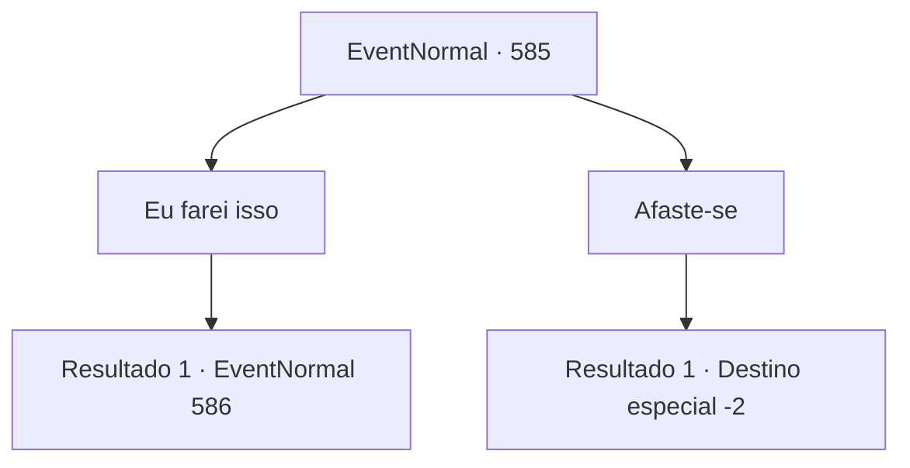

# Eventos normais · 585

[Índice da tabela](index.md) · [Índice geral](../index.md)

ID: `pt:EventNormal:585` · Fonte: `EventNormal4` · Versão: 1.2.47.

Mapeamento estático dos arquivos; a disponibilidade e a execução dependem do estado da run.

## Texto do evento

|drawing_warning| Parece haver uma agitação perto dos portões do castelo de uma pequena cidade. Ao se aproximar, se perguntando o que está acontecendo, você avista um guarda, gritando algo na frente de uma multidão. Os civis começam a murmurar, visivelmente preocupados com o que o guarda está dizendo. 

 "Toda vez que há lua cheia, os aventureiros que vêm para esta cidade estão sendo atacados! Isso deve ser obra do... 'Monstro da Lua Cheia'!"

 Você ouve atentamente o discurso do guarda. Resumindo, eles estão recompensando quem derrotar esse 'Monstro da Lua Cheia'. Felizmente para você, haverá lua cheia esta noite.

## Dados de entrada

```json
{
  "id": 585,
  "grade": 1,
  "place": "",
  "required": "5_700_0"
}
```

## Mapa das escolhas



## Escolhas e resultados

### Escolha 1

Eu farei isso

Requisitos e outros campos da escolha:

```json
{
  "required": ""
}
```

#### Resultado 1.1

Você se aproxima do guarda, declarando que aceitará o trabalho. Ele te examina de cima a baixo, percebe que você é um aventureiro, e então assente. 

 "Tudo bem. Quando terminar, nos encontre no Escritório dos Guardas. Nosso capitão lhe dará seu pagamento."

 Ele então te dá algumas informações sobre o Monstro da Lua Cheia. A criatura é conhecida por ser uma grande besta coberta de pelos pretos, e pode ser encontrada atacando viajantes na estrada que conecta à cidade. 

 "Há uma cabana, em algum lugar longe da cidade. Um caçador vive lá. Ele costumava nos trazer os restos das vítimas, nos informando dos incidentes. Talvez ele saiba mais. Você deveria perguntar a ele."

 Após terminar, o guarda se retira, dizendo que tem outras coisas para fazer. Você olha brevemente ao redor da cidade antes de sair.

Continuação registrada: [Evento 586](0586.md) na mesma tabela.

```json
{
  "required": "",
  "chance": "1",
  "nextEvent": 586,
  "type": 2,
  "reward": ""
}
```

### Escolha 2

Afaste-se

Requisitos e outros campos da escolha:

```json
{
  "required": ""
}
```

#### Resultado 2.1

Você decide ficar em silêncio e sair. Assim como o grupo de civis que está ouvindo o discurso.

Continuação registrada: [Destino especial `-2`](../destinos-especiais.md).

```json
{
  "required": "",
  "chance": "1",
  "nextEvent": -2,
  "type": 2,
  "reward": "5_700_9"
}
```

## Referências que chegam a este evento

Nenhum `nextEvent` positivo da mesma tabela aponta para este nó. Isso não prova que seja inacessível: sorteio e estado de história podem selecioná-lo.

