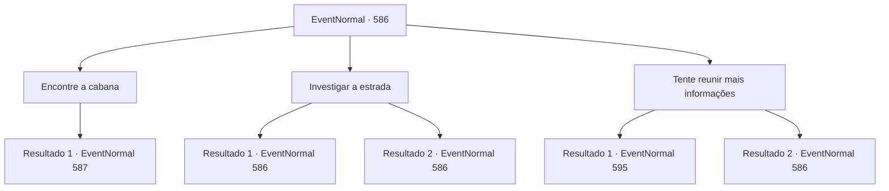

# Eventos normais · 586

[Índice da tabela](index.md) · [Índice geral](../index.md)

ID: `pt:EventNormal:586` · Fonte: `EventNormal4` · Versão: 1.2.47.

Mapeamento estático dos arquivos; a disponibilidade e a execução dependem do estado da run.

## Texto do evento

*Sem texto no arquivo.*

## Dados de entrada

```json
{
  "id": 586,
  "grade": 1,
  "place": "",
  "required": ""
}
```

## Mapa das escolhas



## Escolhas e resultados

### Escolha 1

Encontre a cabana

Requisitos e outros campos da escolha:

```json
{
  "required": ""
}
```

#### Resultado 1.1

Você encontra a cabana que o guarda lhe falou. Ela está localizada no topo de uma pequena colina, a cerca de trinta minutos da cidade. Você bate na porta de madeira de carvalho. Não importa quanto tempo você espere, não recebe resposta. Por fim, decide arrombar a porta, abrindo-a com força. Para sua surpresa, a porta não está trancada - ela se abre imediatamente. Aparentemente, o dono da casa vive sozinho - você nota a pequena quantidade de móveis. Um retrato de uma bela mulher pendurado em uma das paredes chama sua atenção. 

 "Quem é você para entrar na casa de outra pessoa à sua vontade?"

 Então, você ouve a voz de um homem irritado vindo de trás. Ao se virar, você vê um homem corpulento, vestindo roupas no estilo do norte e peles de animais. Este deve ser o caçador sobre o qual o guarda falou.

Continuação registrada: [Evento 587](0587.md) na mesma tabela.

```json
{
  "required": "",
  "chance": "1",
  "nextEvent": 587,
  "type": 2,
  "reward": ""
}
```

### Escolha 2

Investigar a estrada

Requisitos e outros campos da escolha:

```json
{
  "required": "5_701_0"
}
```

#### Resultado 2.1

Você decide verificar a estrada onde os ataques ocorreram. Vestígios visíveis do ataque ainda permanecem ao redor da estrada, apesar do tempo que passou desde então. Pedaços da carruagem quebrada estão espalhados ao redor das moitas, e sangue - aparentemente das vítimas - está respingado aqui e ali. Você também descobre um conjunto de pegadas, presumivelmente feitas pelo Monstro da Lua Cheia. Você examina as pegadas, tentando determinar a direção de onde o monstro veio. As pegadas apontam todas para uma cabana, em algum lugar fora da cidade. A casa do caçador que o guarda mencionou.

Continuação registrada: [Evento 586](0586.md) na mesma tabela.

```json
{
  "required": "",
  "chance": "1|0_7_1",
  "nextEvent": 586,
  "type": 0,
  "reward": "5_701_1"
}
```

#### Resultado 2.2

Você decide verificar a estrada onde os ataques ocorreram. Vestígios visíveis do ataque ainda permanecem ao redor da estrada, apesar do tempo que passou desde então. Pedaços da carruagem quebrada estão espalhados ao redor das moitas, e sangue - aparentemente das vítimas - está respingado aqui e ali. Você também descobre um conjunto de pegadas, presumivelmente feitas pelo Monstro da Lua Cheia. Mas você falha em discernir qualquer coisa delas. Você decide voltar para a cidade.

Continuação registrada: [Evento 586](0586.md) na mesma tabela.

```json
{
  "required": "",
  "chance": "15",
  "nextEvent": 586,
  "type": 1,
  "reward": "5_701_9"
}
```

### Escolha 3

Tente reunir mais informações

Requisitos e outros campos da escolha:

```json
{
  "required": "5_702_0"
}
```

#### Resultado 3.1

Você decide questionar os moradores locais no pub próximo, para descobrir mais sobre o Monstro da Lua Cheia. Um dos bêbados responde à sua pergunta. 

 "*hic* Eu sei de algo sobre essa besta. Mas não espere que eu te conte de mãos vazias."

 Ele sorri, juntando o polegar e o indicador. Um sinal óbvio, exigindo ouro.

Continuação registrada: [Evento 595](0595.md) na mesma tabela.

```json
{
  "required": "",
  "chance": "1|0_12_1",
  "nextEvent": 595,
  "type": 0,
  "reward": ""
}
```

#### Resultado 3.2

Você decide questionar os moradores locais no pub próximo, para descobrir mais sobre o Monstro da Lua Cheia. Mas o lugar está cheio de bêbados que não sabem de nada útil. Infelizmente, você decide desistir e sair.

Continuação registrada: [Evento 586](0586.md) na mesma tabela.

```json
{
  "required": "",
  "chance": "14",
  "nextEvent": 586,
  "type": 1,
  "reward": "5_702_9"
}
```

## Referências que chegam a este evento

- [Evento 585 · escolha 1 · resultado 1](0585.md#escolha-1)
- [Evento 586 · escolha 2 · resultado 1](0586.md#escolha-2)
- [Evento 586 · escolha 2 · resultado 2](0586.md#escolha-2)
- [Evento 586 · escolha 3 · resultado 2](0586.md#escolha-3)
- [Evento 595 · escolha 1 · resultado 1](0595.md#escolha-1)
- [Evento 595 · escolha 2 · resultado 1](0595.md#escolha-2)
- [Evento 596 · escolha 1 · resultado 1](0596.md#escolha-1)
- [Evento 596 · escolha 2 · resultado 1](0596.md#escolha-2)
