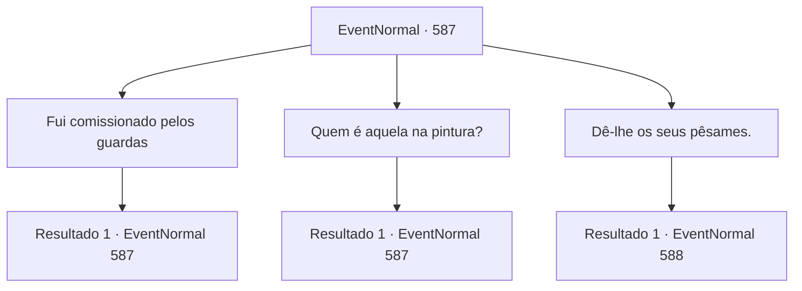

# Eventos normais · 587

[Índice da tabela](index.md) · [Índice geral](../index.md)

ID: `pt:EventNormal:587` · Fonte: `EventNormal4` · Versão: 1.2.47.

Mapeamento estático dos arquivos; a disponibilidade e a execução dependem do estado da run.

## Texto do evento

*Sem texto no arquivo.*

## Dados de entrada

```json
{
  "id": 587,
  "grade": 1,
  "place": "",
  "required": ""
}
```

## Mapa das escolhas



## Escolhas e resultados

### Escolha 1

Fui comissionado pelos guardas

Requisitos e outros campos da escolha:

```json
{
  "required": "5_700_0"
}
```

#### Resultado 1.1

Você diz a ele que os guardas da cidade te deram um trabalho. O caçador suspira, como se entendesse o que você está planejando. 

 "Caminhe para o norte daqui, e você encontrará uma caverna. Vá até lá. Não tenho certeza se é o seu 'O Monstro da Lua Cheia', mas aquela coisa com certeza é feroz."


Continuação registrada: [Evento 587](0587.md) na mesma tabela.

```json
{
  "required": "",
  "chance": "1",
  "nextEvent": 587,
  "type": 2,
  "reward": "5_700_1"
}
```

### Escolha 2

Quem é aquela na pintura?

Requisitos e outros campos da escolha:

```json
{
  "required": "5_700_1"
}
```

#### Resultado 2.1

Você pergunta sobre o retrato na parede. Sobre a senhora no retrato, para ser mais preciso. O caçador te empurra, entrando na cabana ele mesmo. Ele dá uma olhada no quadro, então começa a te contar uma história, entristecido. 

 "Minha esposa. Perdi ela para o monstro que você está caçando. Eu não a merecia. Ela foi morta, tentando me proteger."

 O caçador encara o quadro por um tempo. Enquanto seu olhar cai para o chão, você percebe que seu cabelo está ficando branco aqui e ali, enquanto sua esposa ainda mantém sua juventude, presa dentro do quadro para sempre.

Continuação registrada: [Evento 587](0587.md) na mesma tabela.

```json
{
  "required": "",
  "chance": "1",
  "nextEvent": 587,
  "type": 2,
  "reward": "5_700_2"
}
```

### Escolha 3

Dê-lhe os seus pêsames.

Requisitos e outros campos da escolha:

```json
{
  "required": "5_700_2"
}
```

#### Resultado 3.1

Você dá suas condolências ao caçador. Ele apenas te encara em resposta. 

 "Se você não tem mais negócios, saia da minha casa. Não tenho mais nada a dizer."

 Ele então tira suas armas do guarda-roupa e começa a limpá-las. Besta, lança, machado - todas armas comuns, mas ao observar mais de perto, você percebe que essas armas não são como as que você pode encontrar em uma ferraria local. Todas estão pintadas de preto e têm bordas excepcionalmente afiadas. O caçador continua a limpá-las e afiá-las, sem desviar a atenção para você.

Continuação registrada: [Evento 588](0588.md) na mesma tabela.

```json
{
  "required": "",
  "chance": "1",
  "nextEvent": 588,
  "type": 2,
  "reward": ""
}
```

## Referências que chegam a este evento

- [Evento 586 · escolha 1 · resultado 1](0586.md#escolha-1)
- [Evento 587 · escolha 1 · resultado 1](0587.md#escolha-1)
- [Evento 587 · escolha 2 · resultado 1](0587.md#escolha-2)
