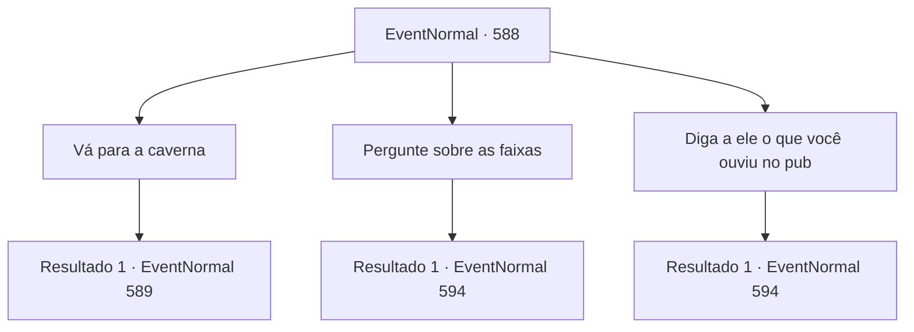

# Eventos normais · 588

[Índice da tabela](index.md) · [Índice geral](../index.md)

ID: `pt:EventNormal:588` · Fonte: `EventNormal4` · Versão: 1.2.47.

Mapeamento estático dos arquivos; a disponibilidade e a execução dependem do estado da run.

## Texto do evento

*Sem texto no arquivo.*

## Dados de entrada

```json
{
  "id": 588,
  "grade": 1,
  "place": "",
  "required": ""
}
```

## Mapa das escolhas



## Escolhas e resultados

### Escolha 1

Vá para a caverna

Requisitos e outros campos da escolha:

```json
{
  "required": ""
}
```

#### Resultado 1.1

Você deixa a cabana, indo em direção à caverna que o caçador mencionou. Depois de caminhar por cerca de uma hora, você chega a uma entrada de uma caverna coberta de musgo. Você percebe um cheiro curioso vindo da caverna. Talvez realmente tenha algo aqui dentro. Você entra cuidadosamente na caverna. Uma escuridão espessa turva sua visão.

Continuação registrada: [Evento 589](0589.md) na mesma tabela.

```json
{
  "required": "",
  "chance": "1",
  "nextEvent": 589,
  "type": 2,
  "reward": ""
}
```

### Escolha 2

Pergunte sobre as faixas

Requisitos e outros campos da escolha:

```json
{
  "required": "5_700_2|5_701_1"
}
```

#### Resultado 2.1

Você pressiona o caçador, mencionando as pegadas que encontrou na estrada. Essas pegadas levaram a este lugar - a cabana do caçador. 

 "...Então você já esteve lá."

 O caçador estala a língua em resposta, agarrando seu machado. Ele então quebra a janela e pula por cima dela, escapando. Você fica surpreso com sua destreza semelhante à de uma fera.

Continuação registrada: [Evento 594](0594.md) na mesma tabela.

```json
{
  "required": "",
  "chance": "1",
  "nextEvent": 594,
  "type": 2,
  "reward": ""
}
```

### Escolha 3

Diga a ele o que você ouviu no pub

Requisitos e outros campos da escolha:

```json
{
  "required": "5_700_2|5_702_1"
}
```

#### Resultado 3.1

Você pressiona o caçador, mencionando o testemunho do bêbado. Se o que ele disse for verdade, o caçador deve ter algo a ver com os ataques. 

 "...Então há uma testemunha."

 O caçador estala a língua em resposta, agarrando seu machado. Ele então quebra a janela e pula por cima dela, escapando. Você fica surpreso com sua destreza semelhante à de uma besta.

Continuação registrada: [Evento 594](0594.md) na mesma tabela.

```json
{
  "required": "",
  "chance": "1",
  "nextEvent": 594,
  "type": 2,
  "reward": ""
}
```

## Referências que chegam a este evento

- [Evento 587 · escolha 3 · resultado 1](0587.md#escolha-3)
