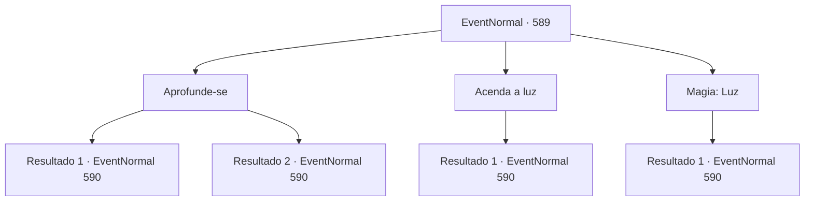

# Eventos normais · 589

[Índice da tabela](index.md) · [Índice geral](../index.md)

ID: `pt:EventNormal:589` · Fonte: `EventNormal4` · Versão: 1.2.47.

Mapeamento estático dos arquivos; a disponibilidade e a execução dependem do estado da run.

## Texto do evento

*Sem texto no arquivo.*

## Dados de entrada

```json
{
  "id": 589,
  "grade": 1,
  "place": "",
  "required": ""
}
```

## Mapa das escolhas



## Escolhas e resultados

### Escolha 1

Aprofunde-se

Requisitos e outros campos da escolha:

```json
{
  "required": ""
}
```

#### Resultado 1.1

Você continua para a parte mais profunda da caverna, avançando pela escuridão. Cada passo que você dá intensifica o mau cheiro. Depois de cerca de cinco minutos, você percebe algo se movendo na escuridão. A próxima coisa que você percebe é que você é jogado para o ar. A besta escondida na caverna te emboscou. Você rapidamente consegue se levantar, se preparando para lutar. O próximo ataque vem logo em seguida, acompanhado por um uivo feroz.

Continuação registrada: [Evento 590](0590.md) na mesma tabela.

```json
{
  "required": "21_26_1|21_27_1",
  "chance": "1",
  "nextEvent": 590,
  "type": 2,
  "reward": "6_3_77",
  "place": 6
}
```

#### Resultado 1.2

Você continua para a parte mais profunda da caverna, avançando pela escuridão. A escuridão não te incomoda. Cada passo que você dá intensifica o mau cheiro. Depois de cerca de cinco minutos, você percebe algo se movendo na escuridão. Ele emite um rosnado gutural e então avança em sua direção. Você se prepara para lutar, tentando descobrir contra o que está enfrentando. É um urso feroz, babando enquanto corre em sua direção.

Continuação registrada: [Evento 590](0590.md) na mesma tabela.

```json
{
  "required": "-1|20_26_1|20_27_1",
  "chance": "1",
  "nextEvent": 590,
  "type": 2,
  "reward": "6_0_77",
  "place": 6
}
```

### Escolha 2

Acenda a luz

Requisitos e outros campos da escolha:

```json
{
  "required": "23_3_1"
}
```

#### Resultado 2.1

Você cria uma fonte de luz e continua para a parte mais profunda da caverna. Cada passo que você dá intensifica o mau cheiro. Após cerca de cinco minutos, você percebe algo se movendo na escuridão. Ele solta um rosnado gutural e então avança em sua direção. Você se prepara para lutar, tentando descobrir contra o que está enfrentando. É um urso feroz, babando enquanto corre em sua direção.

Continuação registrada: [Evento 590](0590.md) na mesma tabela.

```json
{
  "required": "",
  "chance": "1",
  "nextEvent": 590,
  "type": 2,
  "reward": "6_0_77",
  "place": 6
}
```

### Escolha 3

Magia: Luz

Requisitos e outros campos da escolha:

```json
{
  "required": "20_0_1"
}
```

#### Resultado 3.1

Você conjura uma pequena bola de luz, continuando para a parte mais profunda da caverna.  Cada passo que você dá intensifica o mau cheiro.  Depois de cerca de cinco minutos, você percebe algo se movendo na escuridão.  Ele solta um rosnado gutural e então avança em sua direção.  Você se prepara para lutar, tentando descobrir contra o que está enfrentando.  É um urso feroz, babando enquanto corre em sua direção.

Continuação registrada: [Evento 590](0590.md) na mesma tabela.

```json
{
  "required": "",
  "chance": "1",
  "nextEvent": 590,
  "type": 2,
  "reward": "6_0_77",
  "place": 6
}
```

## Referências que chegam a este evento

- [Evento 588 · escolha 1 · resultado 1](0588.md#escolha-1)
