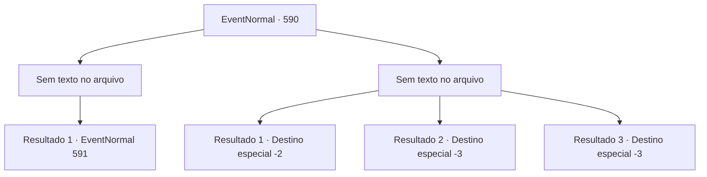

# Eventos normais · 590

[Índice da tabela](index.md) · [Índice geral](../index.md)

ID: `pt:EventNormal:590` · Fonte: `EventNormal4` · Versão: 1.2.47.

Mapeamento estático dos arquivos; a disponibilidade e a execução dependem do estado da run.

## Texto do evento

*Sem texto no arquivo.*

## Dados de entrada

```json
{
  "id": 590,
  "grade": 1,
  "place": "",
  "required": ""
}
```

## Mapa das escolhas



## Escolhas e resultados

### Escolha 1

*Sem texto no arquivo; o papel dessa opção depende da interface do jogo.*

Requisitos e outros campos da escolha:

```json
{
  "required": ""
}
```

#### Resultado 1.1

Um urso selvagem que acabou de acordar de seu sono não é nada menos que uma besta selvagem. No entanto, você é um aventureiro, mais do que capaz de matar tais monstros. Você limpa o sangue do seu corpo e examina o cadáver do urso. Você percebe que sua pele é marrom - espécie comumente encontrada em florestas boreais. De repente, as palavras do guarda ecoam em sua mente. O Monstro da Lua Cheia tem pele preta, não marrom. Você sai da caverna e olha para o céu. Já está escuro - uma brilhante lua cheia ilumina a noite.

Continuação registrada: [Evento 591](0591.md) na mesma tabela.

```json
{
  "required": "",
  "chance": "1",
  "nextEvent": 591,
  "type": 2,
  "reward": ""
}
```

### Escolha 2

*Sem texto no arquivo; o papel dessa opção depende da interface do jogo.*

Requisitos e outros campos da escolha:

```json
{
  "required": ""
}
```

#### Resultado 2.1

Um urso selvagem que acabou de acordar de seu sono não é nada menos que uma besta selvagem. À beira da derrota, você consegue jogar um pouco de poeira em seus olhos. Ele se debate em dor, mas não consegue impedi-lo de escapar.

Continuação registrada: [Destino especial `-2`](../destinos-especiais.md).

```json
{
  "required": "1_0_2|1_1_2",
  "chance": "1",
  "nextEvent": -2,
  "type": 2,
  "reward": "0_0_-1|0_1_-1|5_700_9"
}
```

#### Resultado 2.2

Um urso selvagem que acabou de acordar de seu sono não é nada menos que uma besta selvagem. Você é despedaçado em um pedaço de carne.

Continuação registrada: [Destino especial `-3`](../destinos-especiais.md).

```json
{
  "required": "2_0_2",
  "chance": "1",
  "nextEvent": -3,
  "type": 2,
  "reward": "0_0_-1|0_1_-1"
}
```

#### Resultado 2.3

Um urso selvagem que acabou de acordar de seu sono não é nada menos que uma besta selvagem. Você é despedaçado em um pedaço de carne.

Continuação registrada: [Destino especial `-3`](../destinos-especiais.md).

```json
{
  "required": "2_1_2",
  "chance": "1",
  "nextEvent": -3,
  "type": 2,
  "reward": "0_0_-1|0_1_-1"
}
```

## Referências que chegam a este evento

- [Evento 589 · escolha 1 · resultado 1](0589.md#escolha-1)
- [Evento 589 · escolha 1 · resultado 2](0589.md#escolha-1)
- [Evento 589 · escolha 2 · resultado 1](0589.md#escolha-2)
- [Evento 589 · escolha 3 · resultado 1](0589.md#escolha-3)
