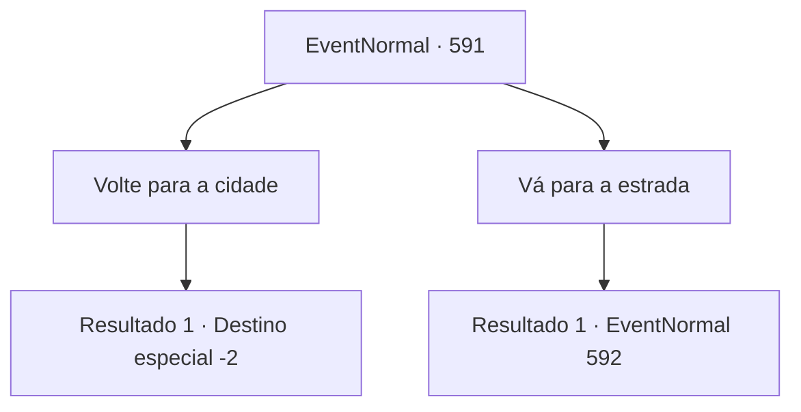

# Eventos normais · 591

[Índice da tabela](index.md) · [Índice geral](../index.md)

ID: `pt:EventNormal:591` · Fonte: `EventNormal4` · Versão: 1.2.47.

Mapeamento estático dos arquivos; a disponibilidade e a execução dependem do estado da run.

## Texto do evento

*Sem texto no arquivo.*

## Dados de entrada

```json
{
  "id": 591,
  "grade": 1,
  "place": "",
  "required": ""
}
```

## Mapa das escolhas



## Escolhas e resultados

### Escolha 1

Volte para a cidade

Requisitos e outros campos da escolha:

```json
{
  "required": ""
}
```

#### Resultado 1.1

Você retorna à cidade após derrotar o urso marrom. Mas a cidade está barulhenta novamente. Guardas armados estão correndo apressadamente para fora dos portões do castelo. Quando você pergunta aos guardas o que estão fazendo, um dos guardas - o mesmo cara que te deu o trabalho - grita com você furiosamente. 

 "Você não fez seu trabalho direito! Houve outro ataque!"

 Ele te diz que o Monstro da Lua Cheia atacou outro aventureiro. Ele te empurra para longe, dizendo que está ocupado, enquanto sai correndo. 

 "Esqueça! Fique fora disso! Você não é de muita ajuda de qualquer maneira."

 Você percebe por si mesmo que, de fato, falhou na missão. Você passa pelos barulhentos portões da cidade, procurando um lugar para passar a noite.

Continuação registrada: [Destino especial `-2`](../destinos-especiais.md).

```json
{
  "required": "",
  "chance": "1",
  "nextEvent": -2,
  "type": 2,
  "reward": "5_700_9"
}
```

### Escolha 2

Vá para a estrada

Requisitos e outros campos da escolha:

```json
{
  "required": ""
}
```

#### Resultado 2.1


 "ARRRRGGH!!"

 Você se apressa para a estrada e, assim que chega, percebe que um colega aventureiro está sendo atacado. Você rapidamente se prepara para lutar, tentando bloquear o atacante. Este 'Monstro da Lua Cheia' não é uma besta - não muito diferente de ursos selvagens em sua aparência externa, mas habilidoso no uso de armas, assim como os humanos. É um licantropo - um werebear. Você se coloca entre o werebear e o aventureiro, pulando na batalha.

Continuação registrada: [Evento 592](0592.md) na mesma tabela.

```json
{
  "required": "",
  "chance": "1",
  "nextEvent": 592,
  "type": 2,
  "reward": "6_0_166",
  "place": 0
}
```

## Referências que chegam a este evento

- [Evento 590 · escolha 1 · resultado 1](0590.md#escolha-1)
