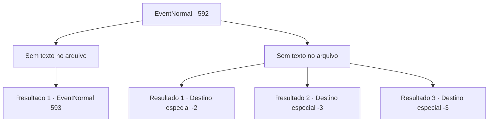

# Eventos normais · 592

[Índice da tabela](index.md) · [Índice geral](../index.md)

ID: `pt:EventNormal:592` · Fonte: `EventNormal4` · Versão: 1.2.47.

Mapeamento estático dos arquivos; a disponibilidade e a execução dependem do estado da run.

## Texto do evento

*Sem texto no arquivo.*

## Dados de entrada

```json
{
  "id": 592,
  "grade": 1,
  "place": "",
  "required": ""
}
```

## Mapa das escolhas



## Escolhas e resultados

### Escolha 1

*Sem texto no arquivo; o papel dessa opção depende da interface do jogo.*

Requisitos e outros campos da escolha:

```json
{
  "required": ""
}
```

#### Resultado 1.1

Incapaz de continuar, o werebear lentamente retorna à sua forma humana. Você reconhece seu rosto humano. O caçador da cabana. Ele era o Monstro da Lua Cheia o tempo todo - a verdadeira identidade do werebear. 

 "*tosse*... Finalmente... Acabou. Você aí, o que está esperando? Vá em frente... e me mate logo."

 Depois de vomitar sangue, ele te encara sem expressão. Você percebe um leve sorriso em seu rosto. É como se ele quisesse que você o matasse.

Continuação registrada: [Evento 593](0593.md) na mesma tabela.

```json
{
  "required": "",
  "chance": "1",
  "nextEvent": 593,
  "type": 2,
  "reward": ""
}
```

### Escolha 2

*Sem texto no arquivo; o papel dessa opção depende da interface do jogo.*

Requisitos e outros campos da escolha:

```json
{
  "required": ""
}
```

#### Resultado 2.1

O werebear acaba sendo um adversário formidável, utilizando tanto a força de um urso quanto as técnicas de um humano. Você consegue evitar golpes letais, mas as lesões vão se acumulando lentamente. Mesmo se conseguir bloquear seus ataques, você é quem acaba sendo empurrado para longe. Tudo o que você pode fazer contra um inimigo assim é ganhar tempo, esperando por reforços. 

 "Ali! O Monstro da Lua Cheia!"

 "FORMAÇÕES! Entrem em suas formações e ataquem!"

 Então, você ouve um grito de batalha alto vindo de longe. Os guardas da cidade chegaram. Você aproveita a oportunidade, deixando o resto para os guardas e fugindo. O werebear se debate furiosamente contra os guardas antes de fugir, desaparecendo na escuridão.

Continuação registrada: [Destino especial `-2`](../destinos-especiais.md).

```json
{
  "required": "1_0_2|1_1_2",
  "chance": "1",
  "nextEvent": -2,
  "type": 2,
  "reward": "0_0_-1|0_1_-1|5_700_9"
}
```

#### Resultado 2.2

O urso louco não para seu ataque, mesmo depois de te derrotar. Somente após te despedaçar em um pedaço de carne é que ele para. 

 "... Eu fiz de novo."

 À medida que a luz da lua diminui, o werebear lentamente volta à sua forma humana. Você vislumbra a verdadeira identidade do werebear. É o caçador da cabana. Mas você não consegue contar a verdade a ninguém, pois a morte lentamente vem te levar.

Continuação registrada: [Destino especial `-3`](../destinos-especiais.md).

```json
{
  "required": "2_0_2",
  "chance": "1",
  "nextEvent": -3,
  "type": 2,
  "reward": "0_0_-1|0_1_-1"
}
```

#### Resultado 2.3

O urso louco não para seu ataque, mesmo depois de te derrotar. Somente após te despedaçar em um pedaço de carne é que ele para. 

 "... Eu fiz de novo."

 À medida que a luz da lua diminui, o werebear lentamente volta à sua forma humana. Você vislumbra a verdadeira identidade do werebear. É o caçador da cabana. Mas você não consegue contar a verdade a ninguém, pois a morte lentamente vem te levar.

Continuação registrada: [Destino especial `-3`](../destinos-especiais.md).

```json
{
  "required": "2_1_2",
  "chance": "1",
  "nextEvent": -3,
  "type": 2,
  "reward": "0_0_-1|0_1_-1"
}
```

## Referências que chegam a este evento

- [Evento 591 · escolha 2 · resultado 1](0591.md#escolha-2)
- [Evento 594 · escolha 1 · resultado 1](0594.md#escolha-1)
