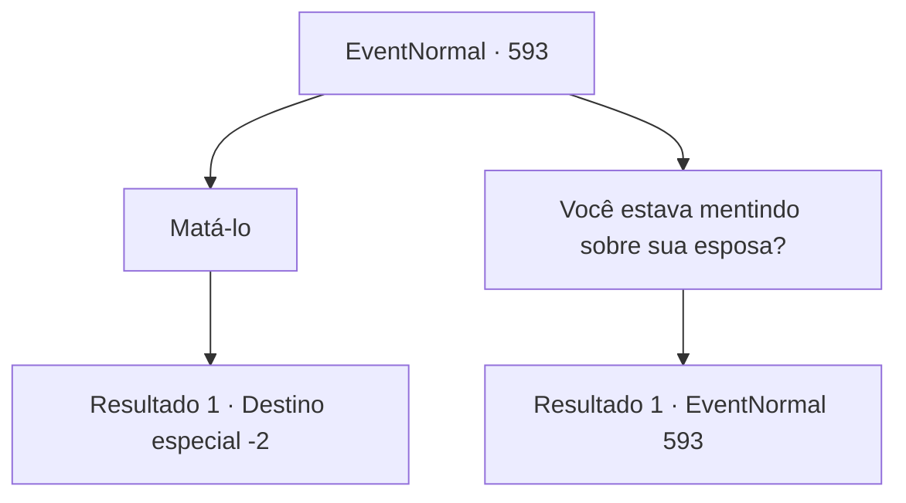

# Eventos normais · 593

[Índice da tabela](index.md) · [Índice geral](../index.md)

ID: `pt:EventNormal:593` · Fonte: `EventNormal4` · Versão: 1.2.47.

Mapeamento estático dos arquivos; a disponibilidade e a execução dependem do estado da run.

## Texto do evento

*Sem texto no arquivo.*

## Dados de entrada

```json
{
  "id": 593,
  "grade": 1,
  "place": "",
  "required": ""
}
```

## Mapa das escolhas



## Escolhas e resultados

### Escolha 1

Matá-lo

Requisitos e outros campos da escolha:

```json
{
  "required": ""
}
```

#### Resultado 1.1

Você termina o caçador e pega seu machado. De alguma forma, ele parece satisfeito, mesmo na morte. 

 "O-obrigado- por me ajudar..."

 Quando ele percebe que a luta acabou, o aventureiro que estava sendo atacado agradece a você. Ele te ajuda em seu caminho de volta para a cidade. O aventureiro conta aos guardas o que aconteceu, para o qual os guardas respondem surpresos. Um grupo de guardas decide investigar a cena para verificar se o aventureiro está falando a verdade. 

 "Após uma inspeção cuidadosa, confirmamos que ele é de fato um werebear. Agradecemos pela sua ajuda. Agora, as pessoas e viajantes desta cidade não precisam mais temer a lua cheia."

 No dia seguinte, o Capitão da Guarda te convoca pessoalmente e te elogia pelo que você fez. Ordenando aos outros guardas que façam o mesmo, ele te dá o pagamento prometido. Todos os guardas te saúdam enquanto você se despede da cidade.

Continuação registrada: [Destino especial `-2`](../destinos-especiais.md).

```json
{
  "required": "",
  "chance": "1",
  "nextEvent": -2,
  "type": 2,
  "reward": "3_186_1|0_4_80|5_700_9"
}
```

### Escolha 2

Você estava mentindo sobre sua esposa?

Requisitos e outros campos da escolha:

```json
{
  "required": "5_700_2"
}
```

#### Resultado 2.1

O caçador coloca um sorriso amargo. 

 "Deixe-me te contar algo. Essa maldição... licantropia... *tosse*... Isso não é algo que eu possa controlar. Não importa o quanto eu tente, eventualmente encontra uma maneira de se libertar, sob a lua cheia."

 Você decide ouvi-lo. O caçador confessa que em sua primeira transformação, ele causou acidentalmente a morte de sua esposa. 

 "...Desde aquele dia, tenho esperado por isso. Então apenas... ponha um fim nisso de uma vez."


Continuação registrada: [Evento 593](0593.md) na mesma tabela.

```json
{
  "required": "",
  "chance": "1",
  "nextEvent": 593,
  "type": 2,
  "reward": "5_700_3"
}
```

## Referências que chegam a este evento

- [Evento 592 · escolha 1 · resultado 1](0592.md#escolha-1)
- [Evento 593 · escolha 2 · resultado 1](0593.md#escolha-2)
