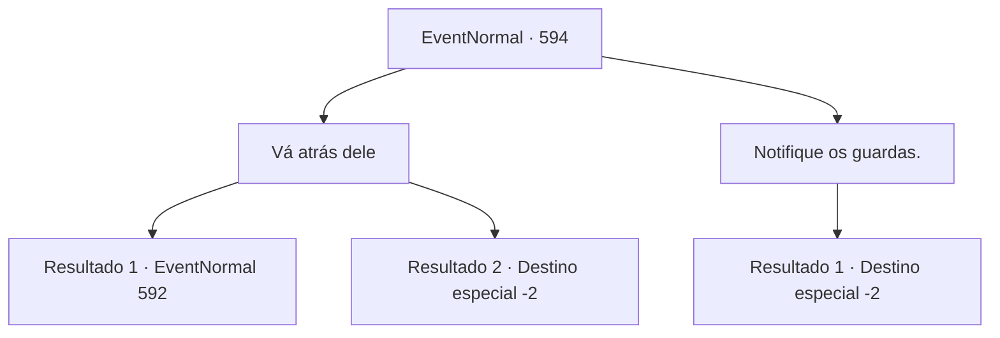

# Eventos normais · 594

[Índice da tabela](index.md) · [Índice geral](../index.md)

ID: `pt:EventNormal:594` · Fonte: `EventNormal4` · Versão: 1.2.47.

Mapeamento estático dos arquivos; a disponibilidade e a execução dependem do estado da run.

## Texto do evento

*Sem texto no arquivo.*

## Dados de entrada

```json
{
  "id": 594,
  "grade": 1,
  "place": "",
  "required": ""
}
```

## Mapa das escolhas



## Escolhas e resultados

### Escolha 1

Vá atrás dele

Requisitos e outros campos da escolha:

```json
{
  "required": ""
}
```

#### Resultado 1.1

Você vai atrás do caçador enquanto ele foge. Ele conhece melhor a geografia local do que você. Ele continua a escapar de sua perseguição tenaz. Quando finalmente consegue encontrá-lo, já é tarde da noite. Você o encurrala em uma caverna próxima, se aproximando lentamente. 

 "A- UUAAARGGH!!"

 Então, um uivo feroz é ouvido. A próxima coisa que você vê é uma criatura correndo para fora da caverna. Não muito diferente de ursos selvagens em sua aparência externa, mas habilidoso no uso de armas, assim como os humanos. É um licantropo - um werebear.

Continuação registrada: [Evento 592](0592.md) na mesma tabela.

```json
{
  "required": "",
  "chance": "1|0_6_1",
  "nextEvent": 592,
  "type": 0,
  "reward": "6_0_166",
  "place": 0
}
```

#### Resultado 1.2

Você vai atrás do caçador enquanto ele foge. Ele conhece melhor a geografia local do que você. Ele escapa facilmente da sua perseguição. Não há muito que você possa fazer daqui. Você volta e retorna à cidade, para o Escritório dos Guardas. 

 "Hmm. Você suspeita do caçador? Tudo bem. Se ele for realmente o culpado que estamos procurando, daremos a você o pagamento prometido."

 Mas o caçador já se foi. Não há vestígios dele em nenhum lugar. O dia do seu pagamento nunca chega. O guarda murmura algo sobre protocolos, dizendo que não pode dar a recompensa a ele. Ele te dá algumas moedas de ouro, pelos seus problemas.

Continuação registrada: [Destino especial `-2`](../destinos-especiais.md).

```json
{
  "required": "",
  "chance": "15",
  "nextEvent": -2,
  "type": 1,
  "reward": "0_4_10|5_700_9"
}
```

### Escolha 2

Notifique os guardas.

Requisitos e outros campos da escolha:

```json
{
  "required": ""
}
```

#### Resultado 2.1

Você decide não ir atrás do caçador, retornando para a cidade. Seu plano é contar aos guardas as informações que você reuniu, em troca da recompensa. 

 "Hmm. Você suspeita do caçador? Tudo bem. Se ele for realmente o culpado que estamos procurando, te daremos o pagamento prometido."

 Mas o caçador já se foi. Não há vestígios dele em lugar algum. O dia do seu pagamento nunca chega. O guarda murmura algo sobre protocolos, dizendo que não pode te dar a recompensa. Ele te dá algumas moedas de ouro, pelos seus problemas.

Continuação registrada: [Destino especial `-2`](../destinos-especiais.md).

```json
{
  "required": "",
  "chance": "1",
  "nextEvent": -2,
  "type": 2,
  "reward": "0_4_10|5_700_9"
}
```

## Referências que chegam a este evento

- [Evento 588 · escolha 2 · resultado 1](0588.md#escolha-2)
- [Evento 588 · escolha 3 · resultado 1](0588.md#escolha-3)
