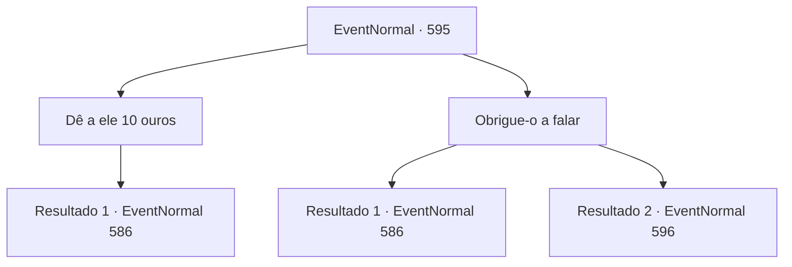

# Eventos normais · 595

[Índice da tabela](index.md) · [Índice geral](../index.md)

ID: `pt:EventNormal:595` · Fonte: `EventNormal4` · Versão: 1.2.47.

Mapeamento estático dos arquivos; a disponibilidade e a execução dependem do estado da run.

## Texto do evento

*Sem texto no arquivo.*

## Dados de entrada

```json
{
  "id": 595,
  "grade": 1,
  "place": "",
  "required": ""
}
```

## Mapa das escolhas



## Escolhas e resultados

### Escolha 1

Dê a ele 10 ouros

Requisitos e outros campos da escolha:

```json
{
  "required": "1_4_10"
}
```

#### Resultado 1.1

Você dá a ele 10 ouros para abrir a boca. O bêbado guarda o ouro, então sussurra em seus ouvidos. 

 "*hic* Já tentou visitar a cabana fora da cidade? Lá vive um caçador... aparentemente ele é do norte ou sei lá... Esse cara mantém um urso de estimação em sua casa. Nada além da verdade, eu juro!"

 O bêbado continua falando sobre como aquele urso deve ser o Monstro da Lua Cheia. Você o escuta por mais alguns minutos antes de sair.

Continuação registrada: [Evento 586](0586.md) na mesma tabela.

```json
{
  "required": "",
  "chance": "1",
  "nextEvent": 586,
  "type": 2,
  "reward": "0_4_-10|5_702_1"
}
```

### Escolha 2

Obrigue-o a falar

Requisitos e outros campos da escolha:

```json
{
  "required": ""
}
```

#### Resultado 2.1

Você dá um tapa forte na bochecha do bêbado. Você repete o processo mais algumas vezes antes de fazer a mesma pergunta novamente. Ele finalmente abre a boca, massageando as cicatrizes em seu rosto. 

 "V- v- você já tentou visitar a cabana fora da cidade? Lá vive um caçador... aparentemente ele é do norte ou sei lá... Esse cara mantém um urso de estimação em sua casa. Nada além da verdade, eu juro!"

 O bêbado divaga sobre como aquele urso deve ser o Monstro da Lua Cheia. Você o ouve por mais alguns minutos antes de sair.

Continuação registrada: [Evento 586](0586.md) na mesma tabela.

```json
{
  "required": "",
  "chance": "1|0_5_1",
  "nextEvent": 586,
  "type": 0,
  "reward": "5_702_1"
}
```

#### Resultado 2.2

Você dá um tapa no bêbado na bochecha, com força. Ele cai no chão, mas logo se levanta, pulando em você. 

 "B- bastardo! Me socando por trás?! VOCÊ SABE QUEM EU SOU?!"


Continuação registrada: [Evento 596](0596.md) na mesma tabela.

```json
{
  "required": "",
  "chance": "13",
  "nextEvent": 596,
  "type": 1,
  "reward": "6_0_61",
  "place": 10
}
```

## Referências que chegam a este evento

- [Evento 586 · escolha 3 · resultado 1](0586.md#escolha-3)
