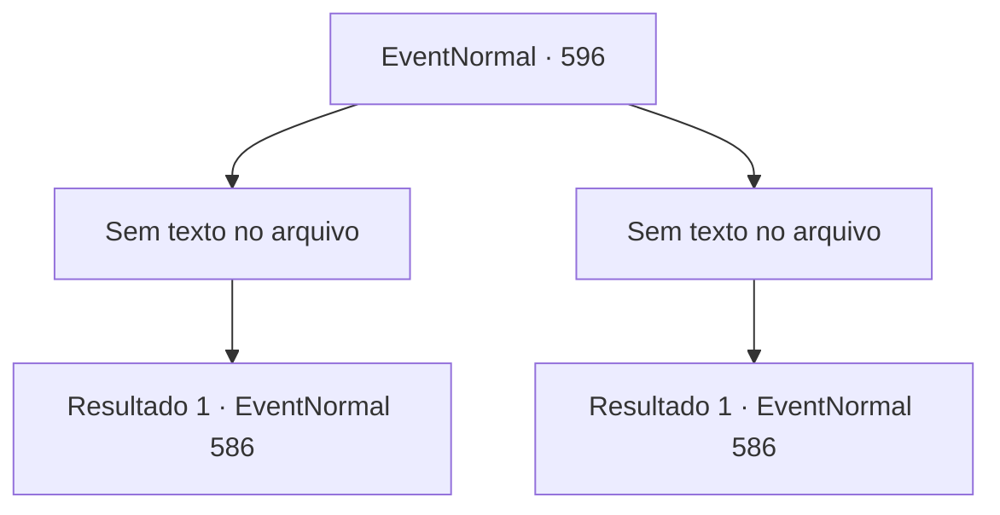

# Eventos normais · 596

[Índice da tabela](index.md) · [Índice geral](../index.md)

ID: `pt:EventNormal:596` · Fonte: `EventNormal4` · Versão: 1.2.47.

Mapeamento estático dos arquivos; a disponibilidade e a execução dependem do estado da run.

## Texto do evento

*Sem texto no arquivo.*

## Dados de entrada

```json
{
  "id": 596,
  "grade": 1,
  "place": "",
  "required": ""
}
```

## Mapa das escolhas



## Escolhas e resultados

### Escolha 1

*Sem texto no arquivo; o papel dessa opção depende da interface do jogo.*

Requisitos e outros campos da escolha:

```json
{
  "required": ""
}
```

#### Resultado 1.1

Você dá uma boa surra no bêbado e faz a mesma pergunta novamente. Ele finalmente abre a boca, massageando as cicatrizes em seu rosto. 

 "J- j- você já tentou visitar a cabana fora da cidade? Lá vive um caçador... aparentemente ele é do norte ou sei lá... Esse cara mantém um urso de estimação em sua casa. Nada além da verdade, eu juro!"

 O bêbado continua falando sobre como aquele urso deve ser o Monstro da Lua Cheia. Você o escuta por mais alguns minutos antes de sair.

Continuação registrada: [Evento 586](0586.md) na mesma tabela.

```json
{
  "required": "",
  "chance": "1",
  "nextEvent": 586,
  "type": 2,
  "reward": "5_702_1"
}
```

### Escolha 2

*Sem texto no arquivo; o papel dessa opção depende da interface do jogo.*

Requisitos e outros campos da escolha:

```json
{
  "required": ""
}
```

#### Resultado 2.1

O bêbado te dá uma boa surra, e você não tem opção a não ser correr para longe do bar. O dono do bar interveio, então você não saiu tão machucado, pelo menos. Você se afasta, juntando seu corpo dolorido.

Continuação registrada: [Evento 586](0586.md) na mesma tabela.

```json
{
  "required": "",
  "chance": "1",
  "nextEvent": 586,
  "type": 2,
  "reward": "5_702_9"
}
```

## Referências que chegam a este evento

- [Evento 595 · escolha 2 · resultado 2](0595.md#escolha-2)
