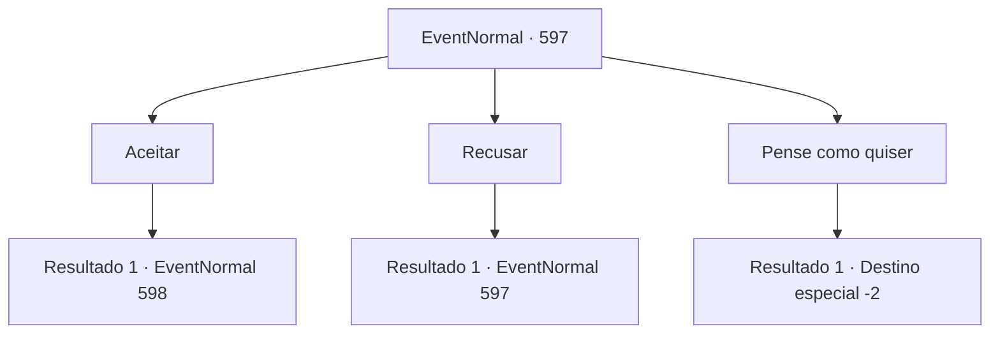

# Eventos normais · 597

[Índice da tabela](index.md) · [Índice geral](../index.md)

ID: `pt:EventNormal:597` · Fonte: `EventNormal4` · Versão: 1.2.47.

Mapeamento estático dos arquivos; a disponibilidade e a execução dependem do estado da run.

## Texto do evento

Na frente da entrada de uma floresta densa, você se depara com Ninien. Ela é a elfa que perdeu para você em um concurso de arco e flecha. Ninien se aproxima de você orgulhosamente, sugerindo que vocês dois compitam novamente. Desta vez, a competição é sobre caça. 

 "Rumor diz que há um monstro muito perigoso vivendo nesta floresta. Eu fiz uma patrulha antes e encontrei as pegadas de um Lobo de Inverno. Quem caçar o lobo vence. O que você acha?"

 Ninien olha fixamente para você, determinada a vencer desta vez. Aparentemente, sua derrota da última vez não conseguiu quebrar seu ego.

## Dados de entrada

```json
{
  "id": 597,
  "grade": 1,
  "place": "",
  "required": "5_311_1|1_2_50"
}
```

## Mapa das escolhas



## Escolhas e resultados

### Escolha 1

Aceitar

Requisitos e outros campos da escolha:

```json
{
  "required": ""
}
```

#### Resultado 1.1

Você aceita a competição de Ninien. Ninien sorri, como se esperasse que você dissesse sim, antes de desaparecer na floresta. Você a segue pelas matas vibrantes. Carvalho, abeto, pinheiro - a floresta está densamente povoada de árvores coníferas que prosperam no inverno. O solo é um pouco resistente, provavelmente devido ao clima frio, mas não apresenta dificuldades no movimento. Você continua sua busca pelo Lobo do Inverno.

Continuação registrada: [Evento 598](0598.md) na mesma tabela.

```json
{
  "required": "",
  "chance": "1",
  "nextEvent": 598,
  "type": 2,
  "reward": "5_311_2"
}
```

### Escolha 2

Recusar

Requisitos e outros campos da escolha:

```json
{
  "required": "5_311_1"
}
```

#### Resultado 2.1

Você recusa a competição de Ninien. Então, Ninien zomba, provocando você. 

 "Ha! Você está preocupado em perder para mim, não está? Você teve sorte da última vez, não é? Que patético!"


Continuação registrada: [Evento 597](0597.md) na mesma tabela.

```json
{
  "required": "",
  "chance": "1",
  "nextEvent": 597,
  "type": 2,
  "reward": "5_311_2"
}
```

### Escolha 3

Pense como quiser

Requisitos e outros campos da escolha:

```json
{
  "required": "5_311_2"
}
```

#### Resultado 3.1

Você passa por ela, dizendo que ela pode pensar o que quiser sobre sua derrota. Ninien continua a exigir uma revanche. Ela só para na sua décima primeira recusa.

Continuação registrada: [Destino especial `-2`](../destinos-especiais.md).

```json
{
  "required": "",
  "chance": "1",
  "nextEvent": -2,
  "type": 2,
  "reward": "5_311_9"
}
```

## Referências que chegam a este evento

- [Evento 597 · escolha 2 · resultado 1](0597.md#escolha-2)
