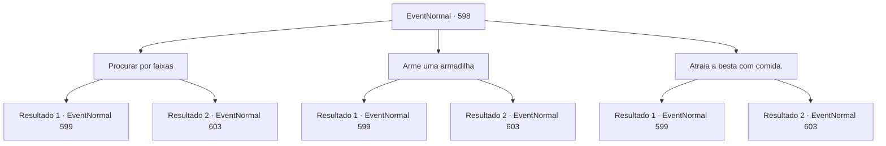

# Eventos normais · 598

[Índice da tabela](index.md) · [Índice geral](../index.md)

ID: `pt:EventNormal:598` · Fonte: `EventNormal4` · Versão: 1.2.47.

Mapeamento estático dos arquivos; a disponibilidade e a execução dependem do estado da run.

## Texto do evento

*Sem texto no arquivo.*

## Dados de entrada

```json
{
  "id": 598,
  "grade": 1,
  "place": "",
  "required": ""
}
```

## Mapa das escolhas



## Escolhas e resultados

### Escolha 1

Procurar por faixas

Requisitos e outros campos da escolha:

```json
{
  "required": ""
}
```

#### Resultado 1.1

Você procura por possíveis pegadas feitas pelo Lobo do Inverno. Pegadas e excrementos aqui e ali mostram vestígios da poderosa besta por toda a floresta. Ao inspecionar as pegadas, você persegue o Lobo do Inverno. Cerca de trinta minutos depois, você se depara com o lobo. Ele está no meio de uma caçada. 

 'GRRRRRRR!' 

 O Lobo do Inverno durante sua caçada está muito atento aos seus sentidos, e percebe imediatamente sua presença. Você se aproxima do lobo, se preparando para lutar. Ele avança primeiro em sua direção com sua enorme boca aberta.

Continuação registrada: [Evento 599](0599.md) na mesma tabela.

```json
{
  "required": "",
  "chance": "1|0_14_1",
  "nextEvent": 599,
  "type": 0,
  "reward": "6_0_88",
  "place": 1
}
```

#### Resultado 1.2

Você procura por possíveis pegadas feitas pelo Lobo do Inverno. No entanto, você não consegue encontrar nada de valor e, pior ainda, se perde no processo. 

 <link=shake>'CCCCRRRRRRAAAAACCKK!!'</link> 

 Depois de uma hora, um desastre repentino acontece. O chão treme enquanto um estrondo ensurdecedor ecoa pela floresta. Felizmente, o terremoto cessa logo em seguida, mas você está longe de estar seguro. 

 "EEEEEEKK!!"

 O som de uma voz familiar gritando do outro lado dos arbustos chama sua atenção. É Ninien, que entrou na floresta antes de você.

Continuação registrada: [Evento 603](0603.md) na mesma tabela.

```json
{
  "required": "",
  "chance": "16",
  "nextEvent": 603,
  "type": 1,
  "reward": ""
}
```

### Escolha 2

Arme uma armadilha

Requisitos e outros campos da escolha:

```json
{
  "required": "8_39_1"
}
```

#### Resultado 2.1

Você prepara armadilhas improvisadas e as espalha pela floresta. Em seguida, se esconde, esperando pelo Lobo do Inverno. Cerca de trinta minutos depois, a besta pisa em uma de suas armadilhas enquanto vagueia. 

  'GRRRRRRR!'  

 As armadilhas improvisadas simplesmente não são fortes o suficiente para conter a força feroz do Lobo do Inverno. Suas armadilhas são quebradas em um instante, e o Lobo do Inverno agora está livre, rosnando para você. Você se aproxima do lobo, se preparando para lutar. Ele avança primeiro em sua direção com sua enorme boca aberta.

Continuação registrada: [Evento 599](0599.md) na mesma tabela.

```json
{
  "required": "",
  "chance": "1|0_6_1",
  "nextEvent": 599,
  "type": 0,
  "reward": "4_39_1|6_0_88",
  "place": 1
}
```

#### Resultado 2.2

Você prepara armadilhas improvisadas e as coloca por toda a floresta. Em seguida, se esconde, esperando pelo Lobo do Inverno. Mas nenhum animal cai na armadilha. Logo você se vê entediado conforme o tempo passa. 

 <link=shake>'CRACCKK!!'</link> 

 Depois de uma hora, um desastre repentino acontece. O chão treme enquanto um estrondo ensurdecedor ecoa pela floresta. Felizmente, o terremoto logo cessa, mas você está longe de estar seguro. 

 "EEEEEEKK!!"

 O som de uma voz familiar gritando vindo de além dos arbustos chama sua atenção. É Ninien, que entrou na floresta antes de você.

Continuação registrada: [Evento 603](0603.md) na mesma tabela.

```json
{
  "required": "",
  "chance": "16",
  "nextEvent": 603,
  "type": 1,
  "reward": ""
}
```

### Escolha 3

Atraia a besta com comida.

Requisitos e outros campos da escolha:

```json
{
  "required": "23_0_1"
}
```

#### Resultado 3.1

Você faz uma pequena fogueira e assa carne, espalhando o cheiro para longe. Cerca de trinta minutos depois, a besta segue o cheiro através da fumaça. 

 'GRRRRRRR!' 

 Não demora muito para o faminto Lobo do Inverno perceber que você não é uma presa fácil. Você se aproxima do lobo, se preparando para lutar. Ele avança primeiro em você com sua enorme boca aberta.

Continuação registrada: [Evento 599](0599.md) na mesma tabela.

```json
{
  "required": "",
  "chance": "1",
  "nextEvent": 599,
  "type": 2,
  "reward": "25_0_1|6_0_88",
  "place": 1
}
```

#### Resultado 3.2

Você faz uma pequena fogueira e assa carne, espalhando o cheiro para longe. Mas nem um filhote de lobo aparece. Logo você se vê entediado à medida que o tempo passa. 

 <link=shake>'CCCCRRRRRRAAAAACCKK!!'</link> 

 Depois de uma hora, um desastre repentino acontece. O chão treme enquanto um estrondo ensurdecedor ecoa pela floresta. Felizmente, o terremoto cessa logo depois, mas você está longe de estar seguro. 

 "EEEEEEKK!!"

 O som de uma voz familiar gritando do outro lado dos arbustos chama sua atenção. É Ninien, que entrou na floresta antes de você.

Continuação registrada: [Evento 603](0603.md) na mesma tabela.

```json
{
  "required": "",
  "chance": "1",
  "nextEvent": 603,
  "type": 2,
  "reward": ""
}
```

## Referências que chegam a este evento

- [Evento 597 · escolha 1 · resultado 1](0597.md#escolha-1)
