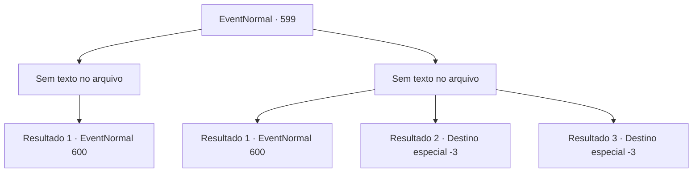

# Eventos normais · 599

[Índice da tabela](index.md) · [Índice geral](../index.md)

ID: `pt:EventNormal:599` · Fonte: `EventNormal4` · Versão: 1.2.47.

Mapeamento estático dos arquivos; a disponibilidade e a execução dependem do estado da run.

## Texto do evento

*Sem texto no arquivo.*

## Dados de entrada

```json
{
  "id": 599,
  "grade": 1,
  "place": "",
  "required": ""
}
```

## Mapa das escolhas



## Escolhas e resultados

### Escolha 1

*Sem texto no arquivo; o papel dessa opção depende da interface do jogo.*

Requisitos e outros campos da escolha:

```json
{
  "required": ""
}
```

#### Resultado 1.1

O Lobo do Inverno lentamente desaba, sangrando. Você recupera o fôlego e se vira. Ninien está aqui, e sua boca já está se contorcendo. 

 "Hmph. Você é um sortudo aventureiro, não é? Tudo bem. Eu perdi. De novo. Vá em frente, ria."

 Ninien te encara, visivelmente frustrada por ter perdido a competição novamente. Então, um desastre repentino acontece. O chão treme enquanto um estrondo ensurdecedor ecoa pela floresta. 

 <link=shake>'CCCCRRRRRRAAAAACCKK!!'</link> 

 Um terremoto é perigoso por si só, mas aparentemente, este não era um terremoto comum. Ninien grita, seu rosto já pálido de medo. 

 "E-esse som...! Um verme de gelo!? P- precisamos fugir! AGORA!"


Continuação registrada: [Evento 600](0600.md) na mesma tabela.

```json
{
  "required": "",
  "chance": "1",
  "nextEvent": 600,
  "type": 2,
  "reward": ""
}
```

### Escolha 2

*Sem texto no arquivo; o papel dessa opção depende da interface do jogo.*

Requisitos e outros campos da escolha:

```json
{
  "required": ""
}
```

#### Resultado 2.1

Logo quando o Lobo do Inverno está prestes a devorar você, uma flecha se planta entre seus olhos. Você olha ao redor, tentando descobrir de onde veio a flecha. Sua resposta está às suas costas. Lá está Ninien, seu arco erguido no ar, sorrindo amplamente. 

 "Você conseguiu encontrar o lobo primeiro, mas eu dei o golpe final com minha flecha. Você admite sua derrota?"

 Ninien começa a rir, olhando para o cadáver do lobo. Então, um desastre repentino acontece. O chão treme enquanto um estrondo ensurdecedor ecoa pela floresta. 

 <link=shake>'CCCCRRRRRRAAAAACCKK!!'</link> 

 Um terremoto é perigoso por si só, mas aparentemente, este não era um terremoto comum. Ninien grita, seu rosto já pálido de medo. 

 "E-esse som...! Um verme de gelo!? P- precisamos fugir! AGORA!"


Continuação registrada: [Evento 600](0600.md) na mesma tabela.

```json
{
  "required": "1_0_2|1_1_2",
  "chance": "1",
  "nextEvent": 600,
  "type": 2,
  "reward": "0_0_-1|0_1_-1"
}
```

#### Resultado 2.2

O Lobo de Inverno é estratégico. Primeiro ele vai para as suas pernas, tirando sua mobilidade. Depois ele quebra sua cintura, impedindo qualquer resistência adicional, e começa o banquete pela sua cabeça. Infelizmente, você encontra seu fim dentro do estômago do lobo.

Continuação registrada: [Destino especial `-3`](../destinos-especiais.md).

```json
{
  "required": "2_0_2",
  "chance": "1",
  "nextEvent": -3,
  "type": 2,
  "reward": "0_0_-1|0_1_-1"
}
```

#### Resultado 2.3

O Lobo de Inverno é estratégico. Primeiro ele vai para as suas pernas, tirando sua mobilidade. Depois ele quebra sua cintura, impedindo qualquer resistência adicional, e começa o banquete pela sua cabeça. Infelizmente, você encontra seu fim dentro do estômago do lobo.

Continuação registrada: [Destino especial `-3`](../destinos-especiais.md).

```json
{
  "required": "2_1_2",
  "chance": "1",
  "nextEvent": -3,
  "type": 2,
  "reward": "0_0_-1|0_1_-1"
}
```

## Referências que chegam a este evento

- [Evento 598 · escolha 1 · resultado 1](0598.md#escolha-1)
- [Evento 598 · escolha 2 · resultado 1](0598.md#escolha-2)
- [Evento 598 · escolha 3 · resultado 1](0598.md#escolha-3)
