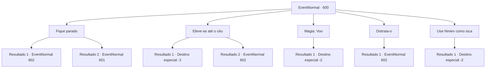

# Eventos normais · 600

[Índice da tabela](index.md) · [Índice geral](../index.md)

ID: `pt:EventNormal:600` · Fonte: `EventNormal4` · Versão: 1.2.47.

Mapeamento estático dos arquivos; a disponibilidade e a execução dependem do estado da run.

## Texto do evento

*Sem texto no arquivo.*

## Dados de entrada

```json
{
  "id": 600,
  "grade": 1,
  "place": "",
  "required": ""
}
```

## Mapa das escolhas



## Escolhas e resultados

### Escolha 1

Fique parado

Requisitos e outros campos da escolha:

```json
{
  "required": ""
}
```

#### Resultado 1.1

Você prende a respiração e fica muito quieto. Vermes de gelo, assim como vermes roxos, rastreiam sua presa com tremorsense. Ninien faz o mesmo, prendendo a respiração e ficando muito quieto. Um breve silêncio se segue. <link=shake><color=blue>

 "KKKKIYAAAAAA!!!"

</color></link> Mas não é o suficiente para enganar o verme de gelo. O chão se despedaça em pedaços, enquanto o verme gigante emerge da terra e avança em sua direção com a boca aberta.

Continuação registrada: [Evento 602](0602.md) na mesma tabela.

```json
{
  "required": "",
  "chance": "1",
  "nextEvent": 602,
  "type": 2,
  "reward": "6_0_167",
  "place": 1
}
```

#### Resultado 1.2

Você prende a respiração e fica muito quieto. Vermes de gelo, assim como vermes roxos, rastreiam sua presa com tremorsense. Ninien faz o mesmo, prendendo a respiração e ficando muito quieta. Um breve silêncio se segue. <link=shake><color=blue>

 "KKKKIYAAAAAA!!!"

</color></link> Mas não é o suficiente para enganar o verme de gelo. O chão se despedaça, enquanto o verme gigante emerge da terra e avança em direção a Ninien com a boca aberta. Ela começa a fugir, assustada, pedindo por sua ajuda.

Continuação registrada: [Evento 601](0601.md) na mesma tabela.

```json
{
  "required": "",
  "chance": "1",
  "nextEvent": 601,
  "type": 2,
  "reward": ""
}
```

### Escolha 2

Eleve-se até o céu

Requisitos e outros campos da escolha:

```json
{
  "required": "20_10_1"
}
```

#### Resultado 2.1

Você pega na mão de Ninien e sobem juntos para o ar. Vermes de gelo, assim como vermes roxos, rastreiam sua presa com tremores. Vocês dois permanecem flutuando por mais alguns minutos, e logo o tremor cessa. Ninien solta um suspiro de alívio, suas orelhas pontudas ainda alertas. 

 "...Foi embora. Podemos voltar ao chão agora."

 Você e Ninien descem lentamente ao chão. Você rola os pés novamente, apenas para ter certeza, mas parece que o verme de gelo já deixou a área. 

 "Bem... Eu odeio admitir, mas você... me ajudou. Vou considerar isso como uma derrota. O vencedor merece uma recompensa. Aqui."

 Ela te entrega seu arco e se afasta. De alguma forma, sua obsessão por competições parece ter desaparecido. Você deixa a floresta, retornando à sua aventura.

Continuação registrada: [Destino especial `-2`](../destinos-especiais.md).

```json
{
  "required": "",
  "chance": "1|0_5_1",
  "nextEvent": -2,
  "type": 0,
  "reward": "0_2_1|3_80_1|5_311_9"
}
```

#### Resultado 2.2

Você pega a mão de Ninien e sobe para o ar. Vermes de gelo, assim como vermes roxos, rastreiam sua presa com tremorsense. Mas a magia falha em carregar seu peso, e os dois caem no chão. <link=shake><color=blue>

 "KKKKIYAAAAAA!!!"

</color></link> Logo após a queda, você ajuda Ninien a se levantar, se preparando para lutar. O chão se despedaça em pedaços, enquanto o verme gigante emerge da terra e avança em sua direção com a boca aberta.

Continuação registrada: [Evento 602](0602.md) na mesma tabela.

```json
{
  "required": "",
  "chance": "16",
  "nextEvent": 602,
  "type": 1,
  "reward": "6_0_167",
  "place": 1
}
```

### Escolha 3

Magia: Voo

Requisitos e outros campos da escolha:

```json
{
  "required": "20_0_2|1_1_2"
}
```

#### Resultado 3.1

Você pega na mão de Ninien e conjura Voo. Vermes de gelo, assim como vermes roxos, rastreiam sua presa com tremores. Os dois flutuam por mais alguns minutos, e logo o tremor cessa. Ninien solta um suspiro de alívio, suas orelhas pontudas ainda alertas. 

 "...Foi embora. Podemos voltar ao chão agora."

 Você e Ninien descem lentamente ao chão. Você rola os pés novamente, apenas para ter certeza, mas parece que o verme de gelo já deixou a área. 

 "Bem... Eu odeio admitir, mas você... me ajudou. Vou considerar isso como uma derrota. O vencedor merece uma recompensa. Aqui."

 Ela te entrega seu arco e se afasta. De alguma forma, sua obsessão por competições parece ter desaparecido. Você deixa a floresta, retornando à sua aventura.

Continuação registrada: [Destino especial `-2`](../destinos-especiais.md).

```json
{
  "required": "",
  "chance": "1",
  "nextEvent": -2,
  "type": 2,
  "reward": "0_1_-1|0_2_1|5_311_9|3_80_1"
}
```

### Escolha 4

Distraia-o

Requisitos e outros campos da escolha:

```json
{
  "required": ""
}
```

#### Resultado 4.1

Você atrai o verme de gelo para si, batendo no chão e gritando. Verme de gelo, assim como vermes roxos, rastreiam sua presa com tremores. O terremoto se intensifica, acompanhado por um barulho mais alto. <link=shake><color=blue>

 "KKKKIYAAAAAA!!!"

</color></link> Você sinaliza Ninien com os olhos, se preparando para lutar. Graças a você, ela está agora a uma distância relativamente segura do verme. O chão se despedaça em pedaços, enquanto o gigantesco verme emerge da terra e avança em sua direção com a boca aberta.

Continuação registrada: [Evento 602](0602.md) na mesma tabela.

```json
{
  "required": "",
  "chance": "1",
  "nextEvent": 602,
  "type": 2,
  "reward": "6_0_167",
  "place": 1
}
```

### Escolha 5

Use Ninien como isca

Requisitos e outros campos da escolha:

```json
{
  "required": "2_3_-14"
}
```

#### Resultado 5.1

Você chuta Ninien, jogando-a no chão. Vermes de gelo, assim como vermes roxos, rastreiam sua presa com tremores. Ela tenta se levantar apressadamente, mas sua luta acaba estimulando mais o verme de gelo. <link=shake><color=blue>

 "KKKKIYAAAAAA!!!"

</color></link> O chão se despedaça em pedaços, enquanto o verme gigante engole Ninien em uma única mordida e desaparece de volta para o chão. Você espera silenciosamente pelo verme de gelo sair da área. Depois que as coisas ficam calmas, você decide sair.

Continuação registrada: [Destino especial `-2`](../destinos-especiais.md).

```json
{
  "required": "",
  "chance": "1",
  "nextEvent": -2,
  "type": 2,
  "reward": "0_2_1|0_3_-3|5_311_9"
}
```

## Referências que chegam a este evento

- [Evento 599 · escolha 1 · resultado 1](0599.md#escolha-1)
- [Evento 599 · escolha 2 · resultado 1](0599.md#escolha-2)
