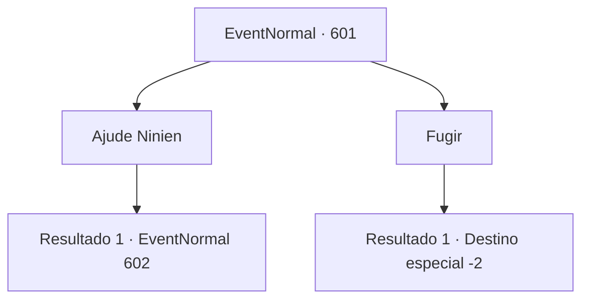

# Eventos normais · 601

[Índice da tabela](index.md) · [Índice geral](../index.md)

ID: `pt:EventNormal:601` · Fonte: `EventNormal4` · Versão: 1.2.47.

Mapeamento estático dos arquivos; a disponibilidade e a execução dependem do estado da run.

## Texto do evento

*Sem texto no arquivo.*

## Dados de entrada

```json
{
  "id": 601,
  "grade": 1,
  "place": "",
  "required": ""
}
```

## Mapa das escolhas



## Escolhas e resultados

### Escolha 1

Ajude Ninien

Requisitos e outros campos da escolha:

```json
{
  "required": ""
}
```

#### Resultado 1.1

Ninien já perdeu sua vontade de lutar. Você ataca o gigante verme de gelo, desviando sua atenção para você. O verme de gelo responde à dor, avançando em você com a boca aberta. Você rola para longe do ataque, rapidamente se levantando para se preparar para a luta.

Continuação registrada: [Evento 602](0602.md) na mesma tabela.

```json
{
  "required": "",
  "chance": "1",
  "nextEvent": 602,
  "type": 2,
  "reward": "6_0_167",
  "place": 1
}
```

### Escolha 2

Fugir

Requisitos e outros campos da escolha:

```json
{
  "required": ""
}
```

#### Resultado 2.1

Você deixa Ninien ao seu destino, fugindo. Ela tropeça e cai enquanto foge e é atacada. Este é seu último momento, antes de desaparecer na boca do verme roxo.

Continuação registrada: [Destino especial `-2`](../destinos-especiais.md).

```json
{
  "required": "",
  "chance": "1",
  "nextEvent": -2,
  "type": 2,
  "reward": "5_311_9"
}
```

## Referências que chegam a este evento

- [Evento 600 · escolha 1 · resultado 2](0600.md#escolha-1)
