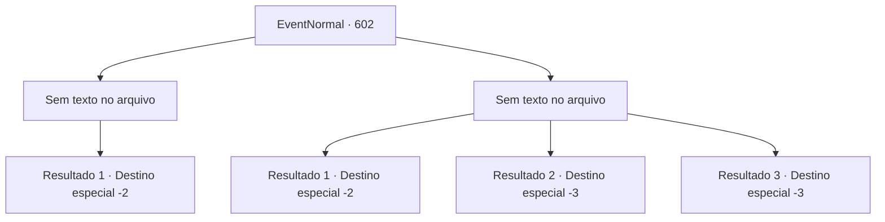

# Eventos normais · 602

[Índice da tabela](index.md) · [Índice geral](../index.md)

ID: `pt:EventNormal:602` · Fonte: `EventNormal4` · Versão: 1.2.47.

Mapeamento estático dos arquivos; a disponibilidade e a execução dependem do estado da run.

## Texto do evento

*Sem texto no arquivo.*

## Dados de entrada

```json
{
  "id": 602,
  "grade": 1,
  "place": "",
  "required": ""
}
```

## Mapa das escolhas



## Escolhas e resultados

### Escolha 1

*Sem texto no arquivo; o papel dessa opção depende da interface do jogo.*

Requisitos e outros campos da escolha:

```json
{
  "required": ""
}
```

#### Resultado 1.1

Eles feriram gravemente o verme de gelo. Não faz muita diferença, no entanto. Verme de gelo são criaturas horríveis, com ou sem ferimentos. Você passa pelo corpo imóvel da criatura, se aproximando de Ninien. Ela te encara, seus olhos arregalados de espanto, antes de limpar a garganta e desviar o olhar. 

 "Bem... Eu odeio admitir, mas você... me ajudou. Aqui, pegue isso."

 Ela te entrega seu arco e se afasta. De alguma forma, sua obsessão por competições parece ter desaparecido. Você deixa a floresta, retornando à sua aventura.

Continuação registrada: [Destino especial `-2`](../destinos-especiais.md).

```json
{
  "required": "",
  "chance": "1",
  "nextEvent": -2,
  "type": 2,
  "reward": "3_80_1|5_311_9"
}
```

### Escolha 2

*Sem texto no arquivo; o papel dessa opção depende da interface do jogo.*

Requisitos e outros campos da escolha:

```json
{
  "required": ""
}
```

#### Resultado 2.1

Você pula para longe da briga, pulando em cima de uma árvore alta. Então, a serpente de gelo olha ao redor antes de ir embora. Seu tremor sentido falhou em localizá-lo. Você pula da árvore e olha ao redor. Ninien não está em lugar algum. Você assume que ela foi comida pela serpente de gelo. Você rapidamente deixa a área, antes que a serpente volte.

Continuação registrada: [Destino especial `-2`](../destinos-especiais.md).

```json
{
  "required": "1_0_2|1_1_2",
  "chance": "1",
  "nextEvent": -2,
  "type": 2,
  "reward": "0_0_-1|0_1_-1|5_311_9"
}
```

#### Resultado 2.2

Mesmo depois de engolir você inteiro, a fome do verme de gelo não é saciada. Pouco depois, ele engole Ninien também. Os dois são lentamente digeridos dentro de sua garganta. Infelizmente, você encontra seu fim, pois o ácido gástrico do verme de gelo te cobre. O fato de você não estar sozinho te conforta um pouco, no entanto.

Continuação registrada: [Destino especial `-3`](../destinos-especiais.md).

```json
{
  "required": "2_0_2",
  "chance": "1",
  "nextEvent": -3,
  "type": 2,
  "reward": "0_0_-1|0_1_-1"
}
```

#### Resultado 2.3

Mesmo depois de engolir você inteiro, a fome do verme de gelo não é saciada. Pouco depois, ele engole Ninien também. Os dois são lentamente digeridos dentro de sua garganta. Infelizmente, você encontra seu fim, pois o ácido gástrico do verme de gelo te cobre. O fato de você não estar sozinho te conforta um pouco, no entanto.

Continuação registrada: [Destino especial `-3`](../destinos-especiais.md).

```json
{
  "required": "2_1_2",
  "chance": "1",
  "nextEvent": -3,
  "type": 2,
  "reward": "0_0_-1|0_1_-1"
}
```

## Referências que chegam a este evento

- [Evento 600 · escolha 1 · resultado 1](0600.md#escolha-1)
- [Evento 600 · escolha 2 · resultado 2](0600.md#escolha-2)
- [Evento 600 · escolha 4 · resultado 1](0600.md#escolha-4)
- [Evento 601 · escolha 1 · resultado 1](0601.md#escolha-1)
- [Evento 603 · escolha 2 · resultado 1](0603.md#escolha-2)
