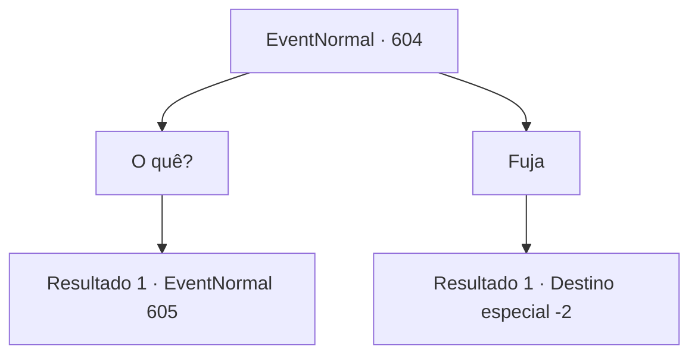

# Eventos normais · 604

[Índice da tabela](index.md) · [Índice geral](../index.md)

ID: `pt:EventNormal:604` · Fonte: `EventNormal4` · Versão: 1.2.47.

Mapeamento estático dos arquivos; a disponibilidade e a execução dependem do estado da run.

## Texto do evento

Você sente um olhar inexplicável e olha ao redor. Então, você avista um corvo grande e rechonchudo. Seus olhos, como obsidiana, brilham enquanto olham para você, e você nota um pequeno chifre saindo de sua cabeça. Nesse momento, palavras humanas emergem do bico do corvo com chifres. 

 "Caw. Ei. Você. Espere."


## Dados de entrada

```json
{
  "id": 604,
  "grade": 1,
  "place": "",
  "required": "18_432_1|5_767_0"
}
```

## Mapa das escolhas



## Escolhas e resultados

### Escolha 1

O quê?

Requisitos e outros campos da escolha:

```json
{
  "required": ""
}
```

#### Resultado 1.1

O corvo se aproxima cautelosamente de você. Inclinando a cabeça, ele te observa cuidadosamente antes de abrir o bico novamente. 

 "Ei. Tenho uma pergunta para você."

 O corvo levanta uma pata para coçar o bico, pausando brevemente como se estivesse pensando, então continua. 

 "Então... há esse grande, uh, Senhor dos Corvos chamado 'Kior.' Ele era tão poderoso que governava três reinos. Mas então, do nada, uma pega chamada 'Daimon' apareceu e o matou, tomando o título de Senhor dos Corvos para si. Agora, nessa situação, o que um simples corvo como eu deveria fazer?"


Continuação registrada: [Evento 605](0605.md) na mesma tabela.

```json
{
  "required": "",
  "chance": "1",
  "nextEvent": 605,
  "type": 2,
  "reward": ""
}
```

### Escolha 2

Fuja

Requisitos e outros campos da escolha:

```json
{
  "required": ""
}
```

#### Resultado 2.1

Você foge do corvo ominoso. O corvo grasna, observando você por um momento, antes de voar para outro lugar.

Continuação registrada: [Destino especial `-2`](../destinos-especiais.md).

```json
{
  "required": "",
  "chance": "1",
  "nextEvent": -2,
  "type": 2,
  "reward": ""
}
```

## Referências que chegam a este evento

Nenhum `nextEvent` positivo da mesma tabela aponta para este nó. Isso não prova que seja inacessível: sorteio e estado de história podem selecioná-lo.

