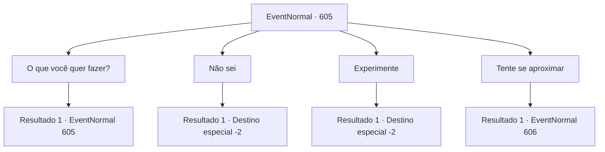

# Eventos normais · 605

[Índice da tabela](index.md) · [Índice geral](../index.md)

ID: `pt:EventNormal:605` · Fonte: `EventNormal4` · Versão: 1.2.47.

Mapeamento estático dos arquivos; a disponibilidade e a execução dependem do estado da run.

## Texto do evento

*Sem texto no arquivo.*

## Dados de entrada

```json
{
  "id": 605,
  "grade": 1,
  "place": "",
  "required": ""
}
```

## Mapa das escolhas



## Escolhas e resultados

### Escolha 1

O que você quer fazer?

Requisitos e outros campos da escolha:

```json
{
  "required": "5_767_0"
}
```

#### Resultado 1.1

Em resposta à sua pergunta, o corvo solta um pequeno suspiro. 

 "Hmm... Não tenho certeza. Acho que vou ter que escolher um novo lado, seja o da pega ou do pardal... Afinal, ele é o senhor agora. Mas do que ele gosta?"

 Os olhos do corvo, parecidos com obsidiana, parecem perfurar você enquanto ele encara. 

 "Eu fiz algumas investigações, e parece que a pega tinha um rancor profundo contra o Lorde Kior. Ouvi dizer que o Lorde Kior prejudicou a família da pega. Então, para se vingar, a pega o derrubou e reivindicou o trono. Mas agora... tudo o que ele faz é se esconder em seu ninho. Eu realmente não sei mais o que fazer."

 O corvo balança a cabeça com um tom de suspiro mais uma vez.

Continuação registrada: [Evento 605](0605.md) na mesma tabela.

```json
{
  "required": "",
  "chance": "1",
  "nextEvent": 605,
  "type": 2,
  "reward": "5_767_1"
}
```

### Escolha 2

Não sei

Requisitos e outros campos da escolha:

```json
{
  "required": ""
}
```

#### Resultado 2.1

Em resposta à sua resposta, o corvo solta um suspiro e voa para longe à distância.

Continuação registrada: [Destino especial `-2`](../destinos-especiais.md).

```json
{
  "required": "",
  "chance": "1",
  "nextEvent": -2,
  "type": 2,
  "reward": "5_767_9"
}
```

### Escolha 3

Experimente

Requisitos e outros campos da escolha:

```json
{
  "required": ""
}
```

#### Resultado 3.1

Você sugere ao corvo que ele desafie a pega. O corvo estala o bico e diz: 

 "Desafiar Daimon? Não, não. Você não entende o quão forte ele é. Eu não estou nem perto do nível dele... Para enfrentá-lo... hmm... Eu precisaria de pelo menos dois outros lordes para me apoiar."

 O corvo inclina a cabeça, pensativo, e então voa para longe na distância.

Continuação registrada: [Destino especial `-2`](../destinos-especiais.md).

```json
{
  "required": "",
  "chance": "1",
  "nextEvent": -2,
  "type": 2,
  "reward": "5_767_9"
}
```

### Escolha 4

Tente se aproximar

Requisitos e outros campos da escolha:

```json
{
  "required": ""
}
```

#### Resultado 4.1

O corvo inclina o bico e diz, 

 "Certo? Essa é provavelmente a melhor ideia, não é? Hmm... Do que aquele homem gosta? Eles estão trancados no castelo e nunca saem, então não há como descobrir..."

 O corvo olha para você e pergunta novamente, 

 "Você é um humano também, então talvez saiba. Se você fosse aquele homem, do que precisaria?"


Continuação registrada: [Evento 606](0606.md) na mesma tabela.

```json
{
  "required": "",
  "chance": "1",
  "nextEvent": 606,
  "type": 2,
  "reward": ""
}
```

## Referências que chegam a este evento

- [Evento 604 · escolha 1 · resultado 1](0604.md#escolha-1)
- [Evento 605 · escolha 1 · resultado 1](0605.md#escolha-1)
