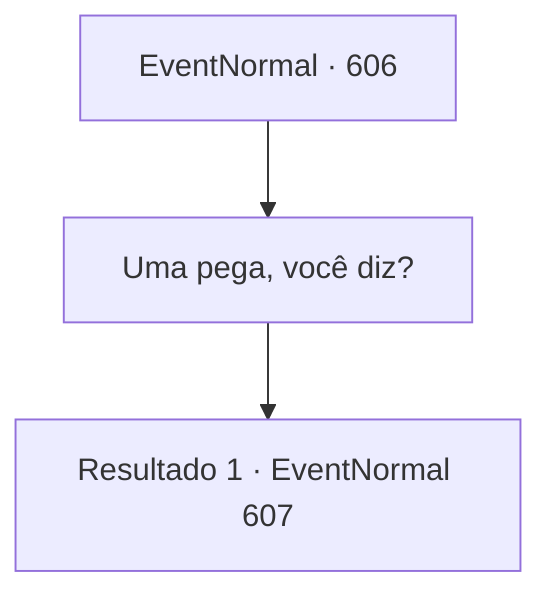

# Eventos normais · 606

[Índice da tabela](index.md) · [Índice geral](../index.md)

ID: `pt:EventNormal:606` · Fonte: `EventNormal4` · Versão: 1.2.47.

Mapeamento estático dos arquivos; a disponibilidade e a execução dependem do estado da run.

## Texto do evento

*Sem texto no arquivo.*

## Dados de entrada

```json
{
  "id": 606,
  "grade": 1,
  "place": "",
  "required": ""
}
```

## Mapa das escolhas



## Escolhas e resultados

### Escolha 1

Uma pega, você diz?

Requisitos e outros campos da escolha:

```json
{
  "required": ""
}
```

#### Resultado 1.1

Quando você pergunta de volta, o corvo faz uma expressão de surpresa. Então, batendo suas asas, ele diz: 

 "Ah, bem, é só uma figura de linguagem, sabe. Enfim, se você fosse aquele sabiá, o que precisaria? Como eu deveria me aproximar para ficar mais perto?"


Continuação registrada: [Evento 607](0607.md) na mesma tabela.

```json
{
  "required": "",
  "chance": "1",
  "nextEvent": 607,
  "type": 2,
  "reward": ""
}
```

## Referências que chegam a este evento

- [Evento 605 · escolha 4 · resultado 1](0605.md#escolha-4)
