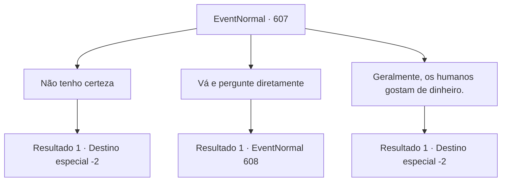

# Eventos normais · 607

[Índice da tabela](index.md) · [Índice geral](../index.md)

ID: `pt:EventNormal:607` · Fonte: `EventNormal4` · Versão: 1.2.47.

Mapeamento estático dos arquivos; a disponibilidade e a execução dependem do estado da run.

## Texto do evento

*Sem texto no arquivo.*

## Dados de entrada

```json
{
  "id": 607,
  "grade": 1,
  "place": "",
  "required": ""
}
```

## Mapa das escolhas



## Escolhas e resultados

### Escolha 1

Não tenho certeza

Requisitos e outros campos da escolha:

```json
{
  "required": ""
}
```

#### Resultado 1.1

Em resposta à sua resposta, o corvo solta um suspiro e voa para longe à distância.

Continuação registrada: [Destino especial `-2`](../destinos-especiais.md).

```json
{
  "required": "",
  "chance": "1",
  "nextEvent": -2,
  "type": 2,
  "reward": "5_767_9"
}
```

### Escolha 2

Vá e pergunte diretamente

Requisitos e outros campos da escolha:

```json
{
  "required": ""
}
```

#### Resultado 2.1

Você diz ao corvo para ir e perguntar diretamente. O corvo hesita por um momento antes de se transformar em um diabrete. 

 "Sério? Os humanos geralmente não gostam de mim?"


Continuação registrada: [Evento 608](0608.md) na mesma tabela.

```json
{
  "required": "",
  "chance": "1",
  "nextEvent": 608,
  "type": 2,
  "reward": ""
}
```

### Escolha 3

Geralmente, os humanos gostam de dinheiro.

Requisitos e outros campos da escolha:

```json
{
  "required": ""
}
```

#### Resultado 3.1

Ouvindo sua resposta, o corvo acena repetidamente e coloca uma pequena moeda de ouro no chão. 

 "Hmm. Eles provavelmente gostam de coisas brilhantes. A maioria dos outros ma—, pegas gosta, afinal de contas. Certo então, entendi. Vou embora agora."

 Com isso, o corvo bate as asas e voa para longe.

Continuação registrada: [Destino especial `-2`](../destinos-especiais.md).

```json
{
  "required": "",
  "chance": "1",
  "nextEvent": -2,
  "type": 2,
  "reward": "5_767_9|0_4_1"
}
```

## Referências que chegam a este evento

- [Evento 606 · escolha 1 · resultado 1](0606.md#escolha-1)
